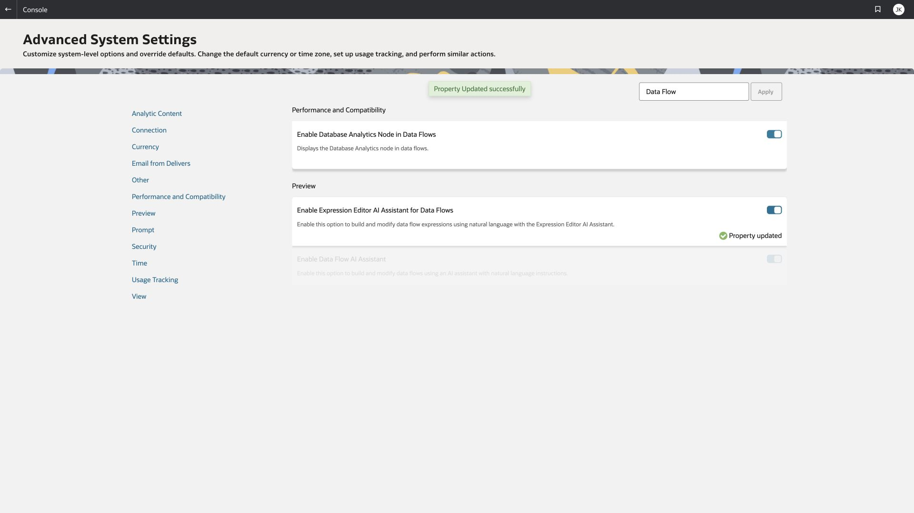

# Facilitator run of show

This guide is for the presenter and technical cohost. The participant runbook is [index.html](index.html). The audience is 15–20 experienced analysts working in their own OAC accounts over Zoom. The agenda totals 180 minutes, including a ten-minute break.

## Delivery format and remaining readiness

The agreed format is seven hands-on feature labs in the original OAC environment plus a verified 15-minute Semantic Modeler instructor demonstration in Industry Analytics. Seven AI capabilities have now worked in rehearsal. A 30-minute Claude Free MCP exercise follows the eight feature labs, within the same 180-minute agenda. Client installation and authentication are pre-work. Expression Assistant still needs the documented manual fallback unless generation is repaired and retested.

The private Industry Analytics model is saved, reopened, exported and consistent with zero errors and warnings. Participant sharing, original-instance availability, a second-account rehearsal and concurrent-user checks remain event gates. See [Industry demo evidence](INDUSTRY_SEMANTIC_DEMO.md). Do not describe the whole event as eight participant hands-on labs.

## Prepare the environment before the meeting

1. Keep the existing ClaimStar_KJ and MPHA Claims Metric Validation as reference assets. Do not reload the database or rebuild the lakehouse for this session.
2. Review [PREPARATION_STATUS.md](PREPARATION_STATUS.md) and open the saved workbook and flow. Verify they reopen correctly.
3. Publish reviewed seed copies in the organization’s approved shared workshop folder with the intended participant group. No new audience or permissions were granted during this preparation. The current seed path is `/My Folders/MPHA_AI_Workshop`; participants cannot access that private folder.
4. Confirm each participant has an individual account and the OAC author privileges needed to create datasets, calculations, workbooks, and data flows. Check the actual application roles with the environment administrator. Semantic authoring additionally requires BI Data Model Author; do not grant this role to everyone merely to run the session.
5. Confirm the participant group can use the existing MaxicareWorkshop connection. Test a dataset copy and workbook save with a second, non-admin participant account. Connection access alone does not prove seed or workbook access.
6. Use participant IDs P01–P20. Give each person a private output location and the naming convention below. Do not use one shared login.
7. Confirm reviewed metadata and indexing on the released base. Preparation expanded ClaimStar_WS_Base to 20 indexed fields, generated the missing helper description, corrected metric descriptions, and initiated a new index. Last Run advanced to 19 October 2026 at 22:24:22 IST. The district chart prompt subsequently succeeded again in the saved workbook. Test the released copy’s Assistant prompt after sharing.
8. In Console → Advanced System Settings, verify **Enable Data Flow AI Assistant** and **Enable Expression Editor AI Assistant for Data Flows** are On. Both were enabled during preparation. Allow propagation time and refresh a saved flow; that refresh exposed Assistant during rehearsal.
9. Inspect Console → Generative AI for model assignments and consumption. Recheck these before the event rather than assuming the rehearsal configuration remains current. Obtain the customer’s normal approval for use of its data with the configured models and regions. The uploaded MPHA fixture is synthetic; real healthcare data may have a different approval scope.
10. Bookmark the Industry Analytics model and rehearse [Lab 7](labs/lab-07-semantic.md). The existing `semmodel` System connection is used only by the instructor. Keep the approved descriptions and screenshots open as a fallback. The model is private and undeployed; do not deploy over the shared Industry Analytics runtime. Full P01 totals are not part of the metadata-demo claim.
11. Resolve Expression Assistant generation, or retain the validated fallback and make the limitation explicit in the presenter introduction.
12. Run a rehearsal with a second participant account. Measure actual generation and flow execution latency. There has been no 15–20-user load test.

## Participant names

| Asset | Name |
| --- | --- |
| Dataset copy | ClaimStar_Pxx |
| Workbook | Claims_AI_Pxx |
| Data flow | Claims_Rollup_Flow_Pxx |
| Flow output | Claims_Rollup_Pxx |
| Instructor semantic model | MPHA_Claims_Semantic_Demo (Industry Analytics) |

Participants use the editor’s **Save As** route for their dataset. A Home Duplicate attempt produced a server error and a non-usable catalog copy during preparation. Do not use the copy named ClaimStar_KJ copy as a seed.

## Facilitation team and Zoom setup

Use one presenter and at least one technical cohost. An optional third person can handle chat and checkpoints. The presenter shares only the OAC application window at a readable desktop scale; the technical cohost helps participants without making the whole class wait.

Before the call, provide the runbook URL or ZIP, instance entry link, participant IDs, account instructions, and asset names. Keep passwords out of the runbook and Zoom chat. Keep a separate browser window for the guide. Use typed, copyable prompts rather than microphone prompts so everyone follows the same text.

At each checkpoint ask for `Pxx green`, `Pxx amber <short error>`, or `Pxx recovered`. Give a participant two minutes for local troubleshooting, then move them to the saved seed or CSV checkpoint. The cohost can continue troubleshooting while the presenter advances.

## Run of show

| Clock | Presenter action | Participant action | Checkpoint |
| --- | --- | --- | --- |
| 0–10 | Introduce grain and source totals | Sign in and confirm ID | Source found; individual access works |
| 10–25 | Show Save As and Dataset Assistant | Create copy; review suggestions | Counts remain Sum measures |
| 25–35 | Generate catalog description | Review and save | Description persisted |
| 35–45 | Explain metadata grain | Generate one missing description and correct it | Helper and ratio descriptions reviewed |
| 45–65 | Generate district chart | Validate, add to canvas, save | Five districts total 1,400 |
| 65–80 | Try expression, use fallback if needed | Validate and format ratio | 8.64% tile |
| 80–90 | Check client and flow readiness | Break after saving | Cohost records recovery needs |
| 90–115 | Generate flow nodes, call execution waves | Review, run and inspect history | 30 rows × 10 columns |
| 115–130 | Switch to Industry Analytics; show saved star and AI metadata | Watch; explain aggregate ratio | 0 errors / 0 warnings; saved metadata |
| 130–145 | Compare narrative tones | Check totals and exact-50% wording | Narrative reviewed |
| 145–175 | Demonstrate Claude MCP discovery, HTML, iframe, native workbook | Preconfigured clients follow; everyone validates both outputs | Default and Central City metrics match |
| 175–180 | Invite two concise findings | Post outputs and fallbacks | Workbook and rollup reconciled |

## Execution waves and capacity

Start flow runs in groups of five: P01–P05, P06–P10, P11–P15, P16–P20. Release the next group after the preceding group completes. Everyone can inspect expressions while waiting. One rehearsal run completed in 22 seconds; do not promise that runtime under concurrent use.

If response times become too long, let participants submit one workbook prompt rather than several follow-ups, inspect the prepared workbook, and use the downloaded rollup checkpoint. The base metadata is already enriched; generating all descriptions in 20 copies is unnecessary.

## Troubleshooting and recovery

| Symptom | Next action | Recovery inside the timebox |
| --- | --- | --- |
| Dataset card stays at Checking permissions | Wait for menu resolution; close and reopen once | Use Open → editor Save As from a working source |
| Duplicate creates a card that cannot open | Treat it as failed until editor access succeeds | Use the tested Save As route; leave source unchanged |
| Shared seed not visible | Check folder and dataset permissions using participant account | Cohost supplies an approved accessible seed; no shared admin login |
| Generated Treat As changes counts to attributes | Reject it and retain Sum measures | Use the prepared metadata |
| AI describes helper as a single claim’s duration | Correct the source grain and numerator meaning | Copy the reviewed wording from Lab 3 |
| Workbook chart uses Row Count | Inspect assignments; count claims with Claims Submitted | Open the prepared chart |
| Add button does not place a chart | Use chart toolbar Add to Canvas | Close drawer and check canvas before proceeding |
| Expression generation error | Select intended dataset; try once more | Use validated, fully qualified formula |
| Bare-field formula fails validation | Insert actual OAC data-element tokens | Use sql/workbook_calculations.txt as logic reference |
| Assistant missing in flow | Check both previews, wait, refresh saved flow | Inspect prepared flow nodes |
| Flow output is not 30 rows | Verify exactly two grouping fields and no extra attributes | Compare with supplied CSV; do not average output ratios |
| Instructor semantic connection not listed | Confirm Industry Analytics instance and the existing semmodel System connection | Use the prepared private model and connection evidence; no participant modeling role is needed |
| Industry demo AI request stalls | Retry once; use the matching real screenshot and reviewed wording | Continue within 15 minutes; preserve the known working private model |
| Old semantic errors remain in Global pane | Click Check to rerun and wait for completion | Show the new result; opening the pane can display the previous check |
| Narrative says more than 50% | Check 413 + 287 = 700 out of 1,400 | Explain the wording error and avoid repeating it |

## Before closing the meeting

Have each participant save their own assets and record which fallbacks were used. Do not delete reference datasets, source tables, connections, or another participant’s objects. Leave cleanup to the agreed retention process after the customer has reviewed outputs.

Keep the Git publication step separate: the package contains tenant screenshots, user identity in some UI chrome, and live environment references. Review them with the workshop owner before publishing to the MPHA repository.

## Industry Analytics 15-minute cue card

- 0–2: switch instance, open the private model, explain the three layers.
- 2–4: show four joins, SUM measures and guarded denial ratio.
- 4–8: Claim Classification → Columns → Rename Columns → Suggest Names; reject the key rename and cancel to preserve replay. Show the actual fact Apply example.
- 8–10: generate a presentation table description; restore reviewed grain and measure wording.
- 10–12: Columns → Detail view → Claims Denial Ratio → Generate Description; restore approved text and save.
- 12–15: rerun consistency with warnings, show 0/0, reopen saved metadata, return to the original OAC tab.

The first-instance save error has not been repaired by this work; the instructor demonstration succeeds in the separate Industry Analytics instance. The hands-on environment still needs to be active and accessible at event time.

## MCP instructor cue card and quota discipline

- Before the event: follow [MCP setup](mcp/README.md), verify Running, confirm synthetic-data approval and dataset access for each configured account. Do not connect 20 participants through the presenter’s Claude or OAC identity.
- 0–4 minutes: one compact catalog search. Show ClaimStar_KJ and ClaimStar_WS_Base, with actual IDs.
- 4–10: one metadata call and one bounded month/district Logical SQL query, then HTML artifact. Validate 30 rows and 1,400 claims. Reuse the reviewed local file.
- 10–16: show exact target approval and the actual two successful saves, then open the SRCDOC iframe workbook. No external website hosting is needed.
- 16–25: show the native JSON mapping and open the native workbook. Select Central City in the native filter: 413 / 84.75% / 10.17% / 252,227.62 paid. Clear selections afterward. The native table uses explicit district aggregation and native percentage formats.
- 25–30: participants compare snapshot HTML with native data-backed visuals and post their validation result. Unconfigured or quota-limited clients use the prepared HTML/JSON and OAC viewing exercises.

The final pair was created via Claude MCP. A local helper corrected a content string/object compatibility issue; the native workbook was then refined and checked locally through MCP without further Claude requests. The utility, private auth state, logs and live Claude configuration are excluded from the deliverable. The portable helper is workshop code and must be rehearsed on other machines.

The recommended live budget is three task requests. Preparation used five compact task requests in total, including two failed save attempts before the helper fix. Do not repeat those failed attempts in class. If a save succeeds without a URL, one catalog search returns the actual viewUrl. Do not paste large JSON into chat. Do not promise Claude Free capacity or OAC 1-OCPU performance for 20 simultaneous client sessions.

## Workshop publication

This module is integrated under [MPHA Lab 8 - AI Powered Business Analytics](https://jayaramu24.github.io/public-healthcare-AIDP-workshop/#lab8) on 21 October 2026. Tenant and account references are rehearsal examples. Use the assigned workshop configuration; private OAC assets are not made public by publishing this guide.
