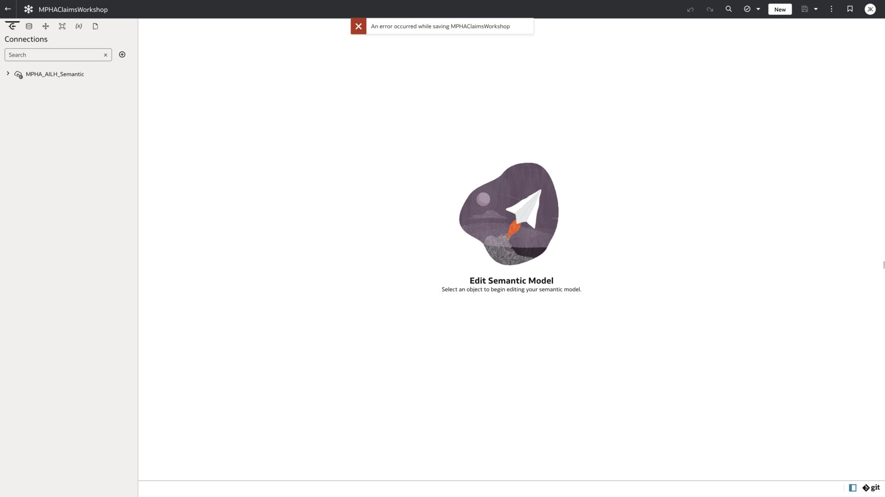

# Preparation status and live evidence

Hands-on assets prepared on 19 October; Industry Analytics instructor demo verified on 20 October 2026. This file distinguishes working results from attempted or documented paths.

## Capability status

| Capability from the supplied feature list | Actual result | Lab |
| --- | --- | --- |
| AI Enrichments | Reused existing AI descriptions; generated missing helper description; corrected its grain; saved reviewed descriptions and 20-column scope; initiated reindexing | 3 |
| Workbook Assistant | Generated district claims chart, checked five district values, and added chart to canvas | 4 |
| Catalog Descriptions | Generated and saved a new catalog description on the isolated base copy | 2 |
| AI Assistant in Data Flows | Generated aggregation, two guarded derived fields, and output node; saved and ran successfully | 6 |
| Dataset Assistant | Generated name suggestions; inspected and rejected inappropriate count-to-attribute recommendations | 1 |
| Expression Assistant | Returned generation error on multiple requests, including explicit dataset selection; manual fallback validated and produced 8.64% | 5 |
| Semantic Modeler Assistant | Industry Analytics private model saved/reopened; names and table/column descriptions generated; seven fact renames applied; all-object consistency 0 errors / 0 warnings; instructor demo only | 7 |
| Language Narratives | Created Factual and Business narrative output; identified and documented an exact-50% wording error | 8 |
| OAC MCP with Claude Free (additional exercise) | Catalog discovery, bounded aggregate query and HTML artifact succeeded; two private workbooks created via Claude MCP; iframe/native rendering, all-district values, five district table rows and Central City filters verified | 9 |

## Reused source assets

- `ClaimStar_KJ` remains the original private dataset. It uses `MaxicareWorkshop` and `ORIGAMI_ADMIN02.MPHA_OAC_STAR_CLAIMS`.
- `MPHA Claims Metric Validation` remains the existing verification workbook, showing 8.64% denial and approximately 13.59 weighted processing days.
- The existing MPHA public-healthcare workshop package supplied the synthetic business scenario, repository structure, and source data contract. Old screenshot images were not substituted for current AI feature results.

## New saved assets

| Asset | Saved location or identity | Verification |
| --- | --- | --- |
| ClaimStar_WS_Base | /My Folders/MPHA_AI_Workshop; object fd0be44f-fdad-4ab7-a332-5f5641002e25 | Opened from a new page; 20 fields; reviewed metadata saved |
| MPHA_Claims_AI_Workshop_Seed | /My Folders/MPHA_AI_Workshop | Saved heading and Last Saved visible; contains district chart, validated denial-rate tile, and Business narrative |
| MPHA_Claims_Rollup_Flow_Seed | /My Folders/MPHA_AI_Workshop; object 303bbe52-dfd9-470e-9984-4cea835da9da | Reopened; Inspect History shows Completed, 22 seconds |
| MPHA_Claims_Rollup_Seed | OAC Dataset Storage; discover through Home search | Opened: 30 rows and 10 fields; CSV downloaded and reconciled independently |
| MPHA_AILH_Semantic | Additional System connection created with user-entered authentication | Available in Semantic Modeler; ORIGAMI_P01 claims tables visible |

The saved seed assets are private. No participant permissions, application roles, or public access were granted. A second-account test and an approved shared seed location remain prerequisites for delivery.

## Model attempts that are not usable starters

| Workspace | Object ID | Observed issue |
| --- | --- | --- |
| MPHA_Claims_AI_Workshop_Seed | 66c015bf-8785-4d3f-a801-9b32d09a14e5 | Start with Empty Model and physical database creation returned model-save error |
| MPHAClaimsWorkshop | b9c6469f-8c33-4910-aafc-0b9bb5fb3030 | Fresh workspace with simple name also failed to initialize/save |

A catalog shell is not a completed model. Neither model was deployed. These original-instance attempts are historical. The Industry Analytics replacement demo has genuine success screenshots and a verified exported model; see [the Industry demo evidence](INDUSTRY_SEMANTIC_DEMO.md). The original MaxicareWorkshop connection had System connection unchecked and locked; that separate prerequisite was resolved by creating MPHA_AILH_Semantic.

See [the reproduction record](SEMANTIC_SAVE_REPRO.md) for environment-owner follow-up.

## Quantitative verification

The OAC output CSV in checkpoints was downloaded from the actual completed flow. A local independent check validated all 30 ratio rows, all 30 weighted-duration rows, status-count reconciliation on every row, uniqueness of district-month grain, and six totals.

| Check | Actual |
| --- | --- |
| District-month rows | 30 |
| Fields | 10 |
| Claims submitted | 1,400 |
| Approved / denied / pending | 1,214 / 121 / 65 |
| Paid amount | 896,370.39 |
| Approximate processing-days numerator | 19,025.2 |
| Overall denial rate | 8.642857…% |
| Weighted processing days | 13.589428… |

The verified original database source has 622 fact rows, 622 distinct four-key grains, 622 joined rows, and zero missing-dimension or status-reconciliation rows. Its period is January–June 2025. These original-schema checks do not prove that the ORIGAMI_P01 copy behind the new connection is identical. A P01 aggregate query through the separate MaxicareWorkshop dataset connection returned a generic OAC request error. Run [the P01 acceptance checks](sql/ORIGAMI_P01_ReadOnly_Acceptance.sql) as the intended semantic source user before extending the Industry Analytics metadata demo to runtime query reconciliation.

## Application changes made

- Enabled Enable Data Flow AI Assistant and Enable Expression Editor AI Assistant for Data Flows; OAC reported property updates successful.
- Created the isolated base, workbook, flow, and output listed above.
- Generated and saved the base catalog description.
- Included Processing Days Total Approx in the base Assistant scope, bringing it to 20 fields, and saved reviewed helper, mean, and ratio descriptions.
- Initiated reindexing; Last Run advanced to 19 October 2026 at 22:24:22 IST. The district chart prompt subsequently succeeded again in the saved workbook (screenshot 57).
- Prepared the additional System connection form with the existing wallet; the user entered authentication and saved it. Wallets, passwords, and credential files are excluded from this package.

## Industry Analytics demo result

The user chose an instructor-only Semantic Modeler demonstration in Industry Analytics. Other labs stay hands-on in the original environment. See [Industry demo evidence](INDUSTRY_SEMANTIC_DEMO.md) and [Lab 7](labs/lab-07-semantic.md).

`MPHA_Claims_Semantic_Demo` (workspace `ea90db2a-459e-4d03-8500-a48bec8ba68c`) uses `semmodel` → `ORIGAMI_P01`. Five physical tables, four physical joins, five logical tables, four logical joins, five presentation folders, seven SUM measures and a guarded logical denial ratio are saved. Assistant names and descriptions were generated successfully. The completed model was closed and reopened; final metadata persisted. All-object consistency with warnings included returned zero errors and zero warnings. A live sampled physical fact preview succeeded. A downloaded export was inspected and its credential-free JSON source is included.

No model was deployed. Full P01 totals, deployed queries and reset archive round-trip import remain unverified; these are boundaries for any future runtime extension, not claims of completion. The 15-minute metadata demonstration uses the saved model and real AI paths. Original workshop totals remain tied to ORIGAMI_ADMIN02.

## Event readiness gates

1. Confirm the original workshop OAC instance is active and the seven hands-on labs reopen before the event. Its availability may have changed since the 19 October rehearsal. Do not assume the 1-OCPU configuration has been tested with 20 concurrent authors.
2. Resolve Expression Assistant generation or announce the validated manual fallback in the workshop introduction.
3. Share reviewed hands-on seeds with the approved participant group and verify dataset, connection, workbook and flow access with a second account. No participant grants were made during preparation.
4. Rehearse representative concurrent users and use flow execution waves. A single successful flow run does not demonstrate 20-user capacity.
5. Open the Industry Analytics instructor model and rehearse its 15-minute slot. Participants do not need accounts in that instance. Keep the reviewed descriptions and screenshot fallback ready.
6. Review tenant references, screenshots and identity visible in UI chrome before updating the MPHA Git repository. No Git files were changed or pushed during this preparation.

## Claude Free MCP result — 20 October 2026

The original OAC instance was resumed by the workshop owner and is active for this verification. The local official MCP utility was retargeted to Origami with the owner’s approval. Read-only discovery found ClaimStar_KJ and ClaimStar_WS_Base. Claude queried 30 district-month aggregate rows and generated the initial HTML. Local review reconciled every row against the existing OAC flow checkpoint and corrected the HTML’s formatting, weighted duration and selector behavior.

With explicit approval, the save tool created **MPHA_MCP_Executive_HTML** and **MPHA_MCP_Executive_Native** in the owner’s private My Folders / MPHA_AI_Workshop. Both saves returned status ok (200). Catalog read-back supplied the actual IDs and view URLs; both opened in OAC. The native JSON was refined only for this approved existing ID and retrieved again after saving. No source, shared workshop asset or catalog ACL was changed.

The HTML iframe and native workbook both show 1,400 submitted, 86.71% approved, 8.64% denied and 896,370.39 paid. Central City filtering shows 413, 84.75%, 10.17% and 252,227.62 paid, with approximately 13.63 weighted days. Every district row in the native summary matches the reviewed HTML after its explicit district-grain correction. Native paid display uses this account’s locale digit grouping; currency remains unspecified.

See [live verification and exact links](mcp/verification.json), [Lab 9](labs/lab-09-mcp-claude.md) and [setup/artifacts](mcp/README.md). Browser evidence is 1920 × 1080 and native Claude evidence 2400 × 1600, unedited. The tested route is Claude Desktop Free plus local stdio; a remote custom connector was not tested.

Remaining event gates include participant client pre-work and third-party data approval, dataset sharing/access, a non-admin account rehearsal, and capacity validation. The saved presenter workbooks remain private. HTML is a dated snapshot; native visuals query the OAC dataset. The original Semantic Modeler save defect and Expression Assistant generation limitation are not repaired by this workbook exercise.

## Workshop publication

This module is integrated under [MPHA Lab 8 - AI Powered Business Analytics](https://jayaramu24.github.io/public-healthcare-AIDP-workshop/#lab8) on 21 October 2026. Tenant and account references are rehearsal examples. Use the assigned workshop configuration; private OAC assets are not made public by publishing this guide.
