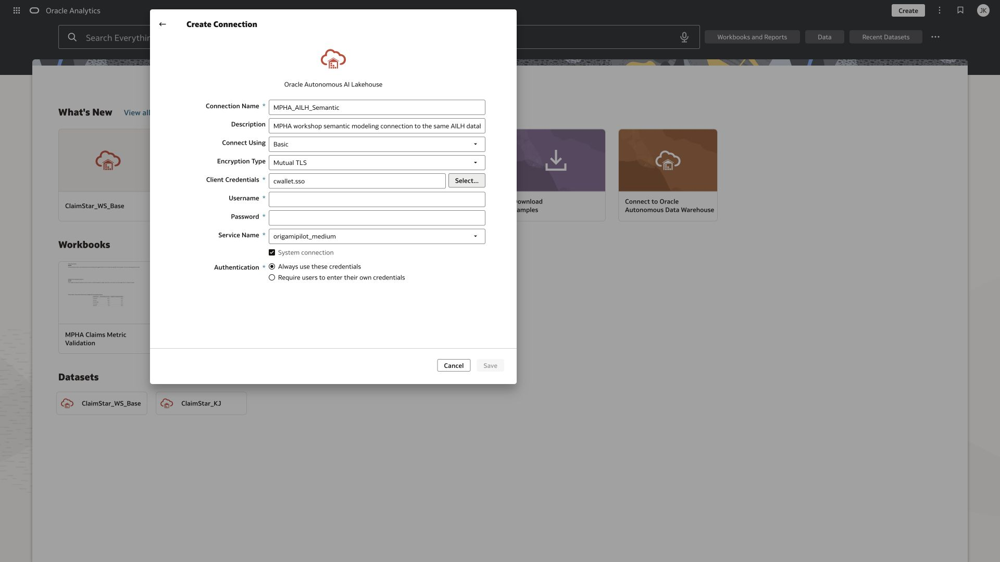
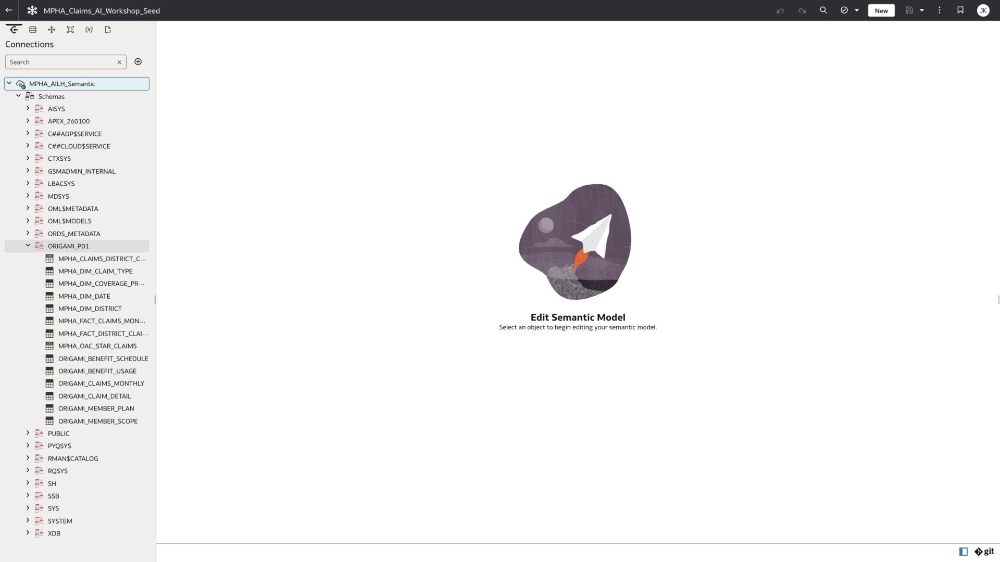

# Original-instance Semantic Modeler save failure: historical record

Observed on 19 October 2026 in the original OrigamiOAC environment. This remains an unresolved original-instance issue. The workshop now uses a verified Industry Analytics instructor demo for Lab 7; see [its evidence](INDUSTRY_SEMANTIC_DEMO.md). This is a local handoff record; no support request has been sent.

## What works

- The additional `MPHA_AILH_Semantic` connection was saved with System connection selected after the user supplied authentication.
- Semantic Modeler lists that connection and can browse `ORIGAMI_P01`, including the monthly claims fact and four dimensions.
- Dataset, workbook, and data-flow saves succeed elsewhere in the same signed-in session.

## Reproduce

1. Open Navigator → Semantic Models.
2. Create a model in the author's private workshop folder.
3. Choose Start with Empty Model.
4. Wait for Saving to finish.
5. Observe `An error occurred while saving MPHAClaimsWorkshop`.
6. Reload the workspace. It returns to its starting choices rather than reopening a persisted empty model.

Creating a physical database in the first workspace also produced a save failure. A second, fresh workspace with a simple name reproduced the empty-model failure. The screenshot below shows the second attempt.

| Attempt | Model object ID |
| --- | --- |
| MPHA_Claims_AI_Workshop_Seed | 66c015bf-8785-4d3f-a801-9b32d09a14e5 |
| MPHAClaimsWorkshop | b9c6469f-8c33-4910-aafc-0b9bb5fb3030 |

The browser console contained a generic create-entity error and did not identify a root cause. Do not infer a database credential failure from this message: connection browsing succeeds, while model persistence fails. The model catalog shells do not constitute usable starters. Neither was deployed.

## Environment-owner follow-up

Verify the author's Semantic Modeler application roles, folder authoring rights, service health, and relevant server diagnostics. These are diagnostic checks, not established causes. Reproduce with a fresh empty private model before importing data. Collect an approved diagnostic bundle or request trace if needed, keeping authentication headers, cookies, passwords, and wallet contents out of the workshop repository.

The workshop owner selected the separate Industry Analytics instance for a 15-minute instructor-only demo. [Lab 7](labs/lab-07-semantic.md) now contains verified naming, description, consistency and save/reopen screenshots from that instance. The other labs remain hands-on in the original OAC environment. This change does not establish the root cause or repair the original service issue.

