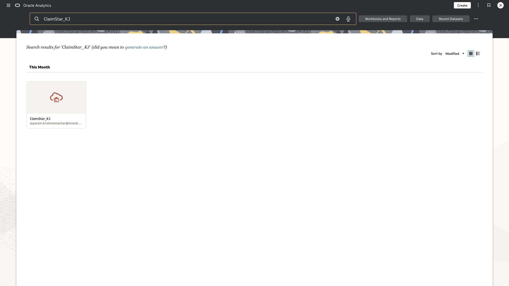

# Lab 0 Get ready for the MPHA workshop

**Time:** 10 minutes  |  **Rehearsal status:** Required

In this three-hour workshop, experienced analysts use Oracle Analytics Cloud AI features to investigate MPHA healthcare claims. You will prepare metadata, build and validate visualizations, create a rollup data flow, compare narratives with the numbers that support them, and use Claude MCP to discover data and build an HTML overview with a native OAC recreation. MPHA is the synthetic healthcare scenario in the existing workshop kit.

> Updated 20 October 2026: seven AI capabilities have now been exercised successfully. Lab 7 is a 15-minute instructor demonstration in Industry Analytics using the saved MPHA_Claims_Semantic_Demo model and semmodel connection. The seven other AI feature labs remain hands-on in the original workshop OAC environment. Lab 9 adds a Claude Free MCP demonstration with optional preconfigured participant clients and dashboard validation. Expression Assistant generation still uses its validated manual fallback. Participant access, an active workshop instance and a second-account rehearsal remain event readiness gates.

## Objectives

- Use ClaimStar_KJ through your own workshop dataset copy.
- Check AI outputs against known claims totals and aggregation rules.
- Finish with an individual workbook and a district-month rollup.
- Recognize the difference between generated metadata, calculated metrics, and a semantic model.

## Task 1 Sign in and establish your participant identity

1. Open the OAC instance supplied by the facilitator. Use your own assigned account. Keep this guide in a separate browser window.
2. Use the participant ID supplied in Zoom, P01 through P20. Replace Pxx in every asset name with that ID. Do not use another participant’s name.
3. At Home, search for ClaimStar_KJ or the released workshop base ClaimStar_WS_Base. Use the dataset card, not a natural-language answer suggestion.
4. Confirm the facilitator has made the seed available to your account. The rehearsal seed is currently in the facilitator’s private /My Folders/MPHA_AI_Workshop folder. A participant-access test is required before delivery.

*Home search for the original ClaimStar_KJ dataset at 1920 × 1080.*

## Task 2 Check the data contract

| Item | Expected |
| --- | --- |
| Dataset grain | One monthly district × coverage program × claim classification segment |
| Source rows | 622 segments |
| Period | January through June 2025; Service Month uses month-start dates |
| Claims submitted / approved / denied / pending | 1,400 / 1,214 / 121 / 65 |
| Paid total | 896,370.39; do not invent a currency label |
| Overall denial rate | 121 ÷ 1,400 = 8.642857…%, displayed as 8.64% |
| Weighted processing days | 19,025.2 ÷ 1,400 = 13.589428… days, displayed as approximately 13.59 |
| Output rollup grain | 30 district-month rows; six months × five districts |

> Average Processing Days is a rounded segment mean. Processing Days Total Approx reconstructs a numerator as that mean multiplied by Claims Submitted. The resulting weighted mean is approximate. Denial Rate is a stored segment ratio: never sum it, and never average it without the correct denominator.

## Task 3 Use Zoom checkpoints

1. Keep your microphone muted while working and paste prompts from this guide. Use chat for your participant ID and short status messages.
2. When the facilitator calls a checkpoint, post Pxx green when complete, Pxx amber with the exact blocker when stuck, or Pxx recovered when you used the fallback.
3. Do not share credentials in chat. If you fall behind for more than two minutes, open the prepared seed and rejoin at the next task.

[Back to workshop contents](../README.md)
