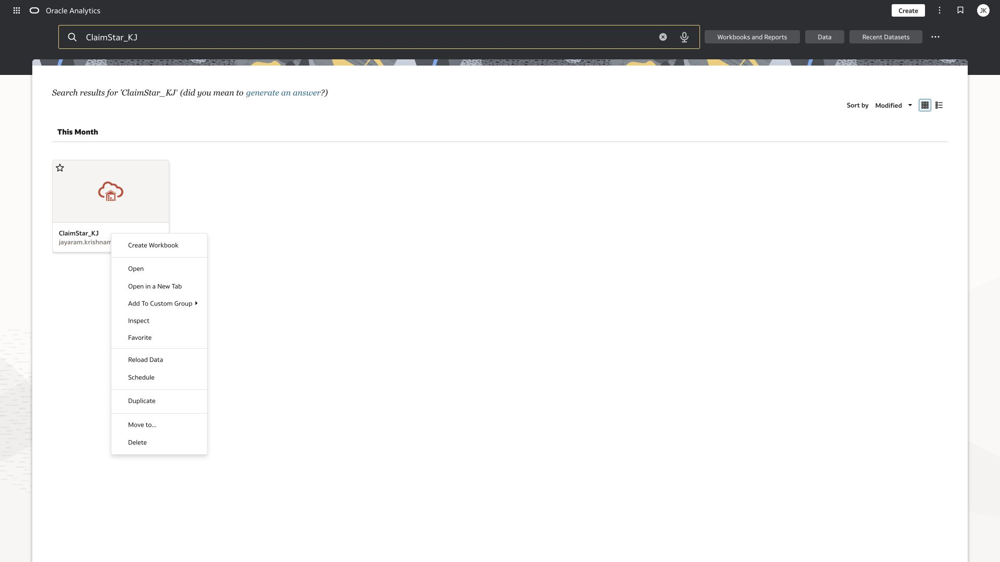
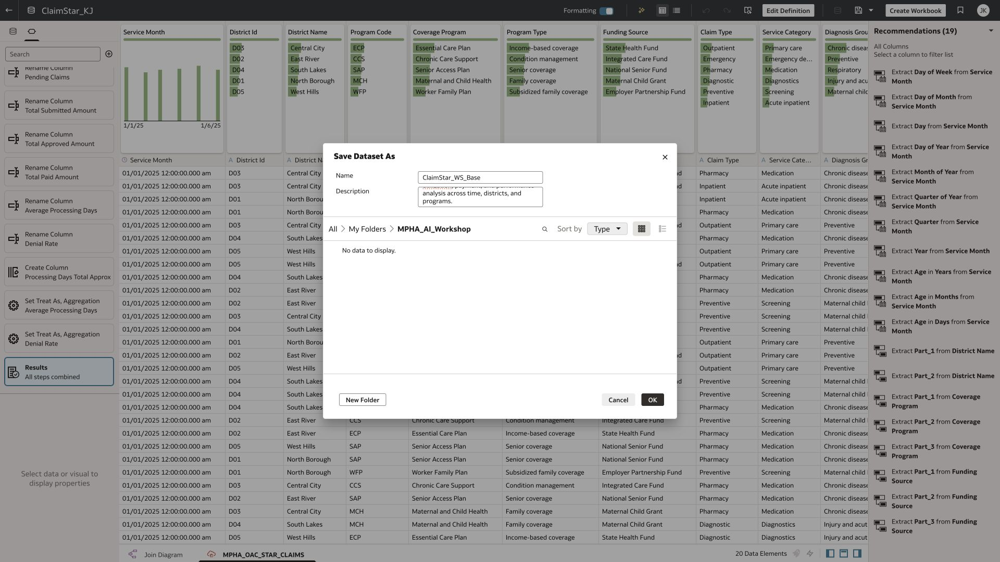
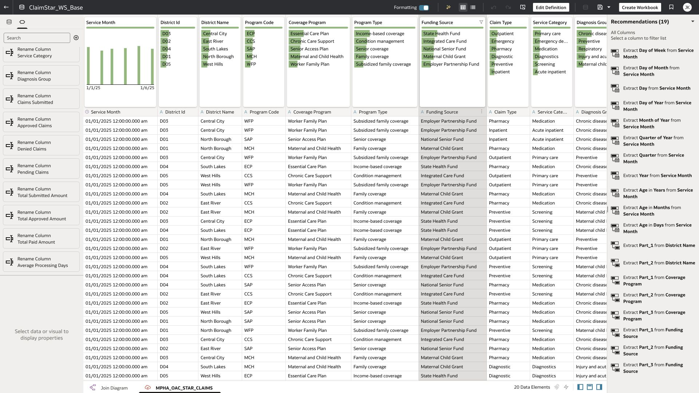

# Lab 1 Prepare a dataset with Dataset Assistant

**Time:** 15 minutes  |  **Rehearsal status:** Verified with review exercise

You will create an individual copy, inspect suggested column names, and decide whether suggested attribute and measure types fit the claims model. The source already has friendly names, so reviewing a suggestion is a valid result.

## Task 1 Create your dataset copy

1. On the dataset card, open Actions and select Open. Wait for permission checking to finish before choosing an action.
2. In the transform editor, open the arrow beside Save Dataset and select Save As. During rehearsal this succeeded when the Home Duplicate action returned a server error.
3. Enter ClaimStar_Pxx. Save in My Folders or a participant folder assigned by the facilitator. Click OK, wait for completion, and verify the editor heading uses your new name.
4. Confirm 20 data elements are present. The left Preparation Script already contains renames and the Processing Days Total Approx helper. Reuse these prepared steps.

*Dataset actions. Use Open; the editor Save As route is the tested recovery from the failed Duplicate request.*

*Editor Save As used to create the rehearsal base. Participants use ClaimStar_Pxx instead of ClaimStar_WS_Base.*

*Successful saved base copy. Always check the heading after Save As.*

## Task 2 Generate and review column names

1. In the transform editor, click the Magic Wand icon. This opens Dataset Assistant Table Recommendations.
2. Keep the Column Rename tab selected. Inspect Case and Replace, then click Generate Column Names.
3. Compare Current and New. In rehearsal the assistant suggested Approximate Total Processing Days for Processing Days Total Approx. Existing friendly names mostly stayed the same.
4. For the core exercise, keep the existing names so later prompts match this guide. Close the recommendations without applying the rename. In your own copy you may apply a chosen rename, but then adapt every subsequent prompt and expression.

*Column Rename settings before generation on ClaimStar_WS_Base.*

*Generated name suggestions. Review the change before applying it.*

## Task 3 Review Treat As suggestions

1. Reopen Magic Wand if necessary and choose Treat As.
2. Inspect the four claim count fields. Rehearsal suggested changing Claims Submitted, Approved Claims, Denied Claims, and Pending Claims from measures to attributes.
3. Reject that suggestion for this reporting model: these counts must remain additive measures with Sum aggregation. Close the recommendation panel.
4. Use Metadata view to confirm the counts and monetary totals are measures. Keep Average Processing Days and Denial Rate as non-additive attributes. Save your dataset if you made an intentional correction.

*Actual Treat As suggestions that should be rejected for the claims analysis.*

## Checkpoint

Your own dataset opens with 20 data elements. Claims counts remain Sum measures. You can explain why a plausible AI recommendation can be unsuitable for the business model.

[Oracle documentation for Dataset Assistant renaming](https://docs.oracle.com/en/cloud/paas/analytics-cloud/acubi/rename-columns-using-ai-assistant.html)

[Oracle documentation for column type recommendations](https://docs.oracle.com/en/cloud/paas/analytics-cloud/acubi/change-column-types-using-ai-assistant.html)

[Back to workshop contents](../README.md)
