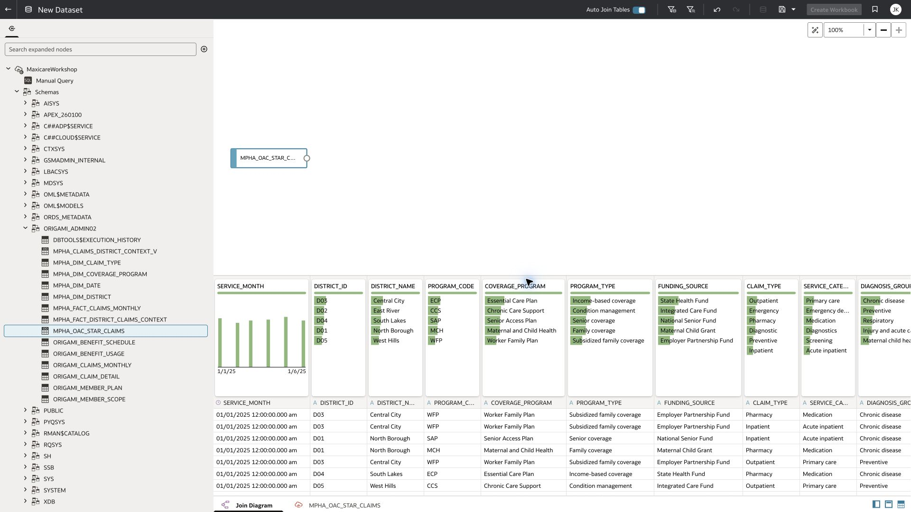
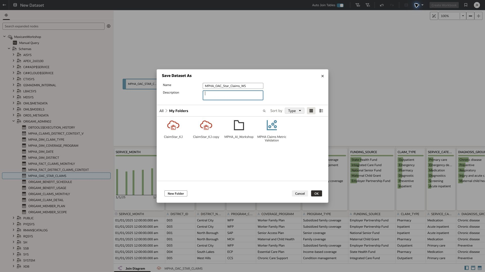
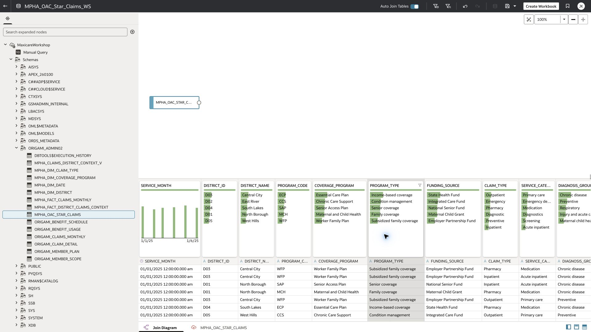
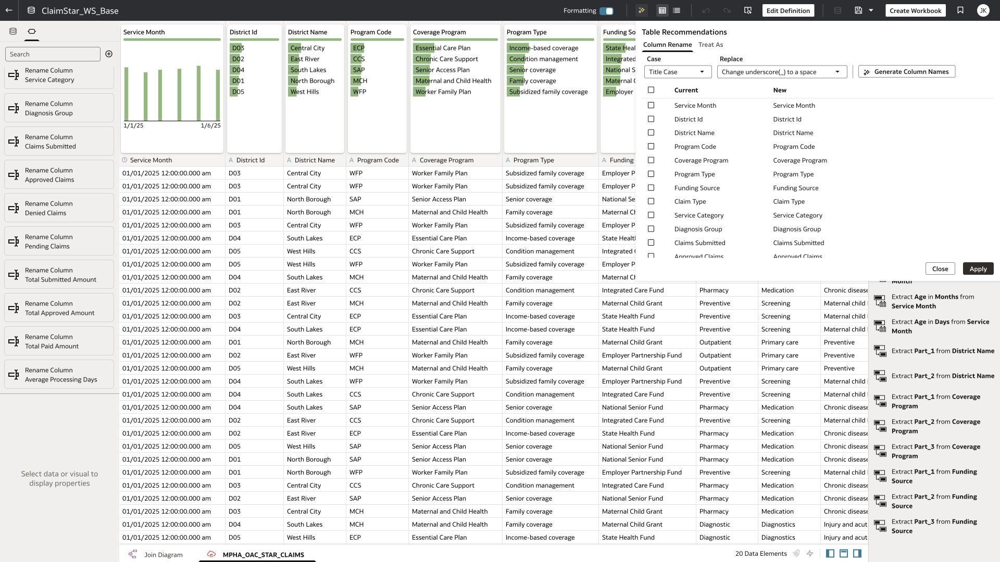
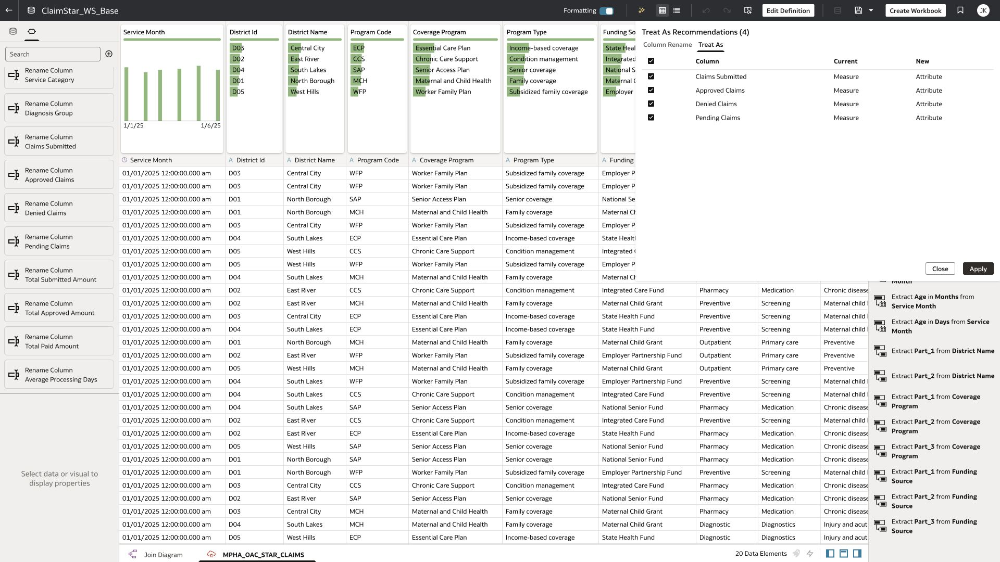
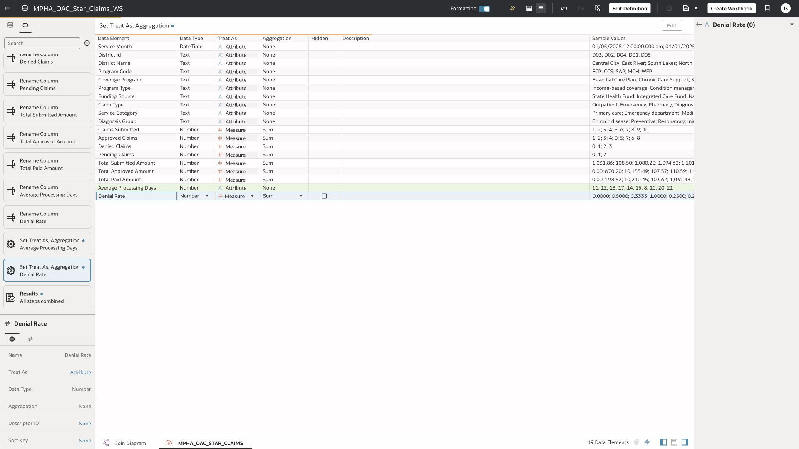

# Exercise 1: connect to the flattened claims view and review Dataset Assistant

20 minutes · Verified: fresh source saved; 19 friendly fields

Reuse the AILH connection already supplied to you. This exercise creates a dataset over the flattened view; no database connection provisioning or join construction is needed.

## Task 1 Create and save your dataset

1. From Home choose Create → Dataset. Select the existing MaxicareWorkshop connection.
2. Expand ORIGAMI_ADMIN02 and select MPHA_OAC_STAR_CLAIMS. Add only this flattened view to the dataset canvas, then open its data.
3. Inspect the 622 source rows and 19 columns. Save as MPHA_Claims_Pxx in your own My Folders. Wait for the saved dataset name to appear.
4. If the view/connection is missing, stop and use the released prepared dataset. Report your Pxx ID and the missing object to the co-facilitator; do not create a new database connection during class.

## Task 2 Generate, review and apply column names

1. Open the dataset transform editor. Click the Magic Wand to open Dataset Assistant → Column Rename.
2. Select Title Case and replace underscore (_) with a space. Click Generate Column Names. Review Current and New before applying.
3. Apply the reviewed names before creating charts or expressions. Rename Avg Processing Days explicitly to Average Processing Days if needed. Use the mapping below; District Id is an identifier, not a metric.
4. Save and verify the friendly names. Later renames can break workbook bindings, so complete this step first.

| Source column | Prepared name |
| --- | --- |
| SERVICE_MONTH | Service Month |
| DISTRICT_ID | District Id |
| DISTRICT_NAME | District Name |
| PROGRAM_CODE | Program Code |
| COVERAGE_PROGRAM | Coverage Program |
| PROGRAM_TYPE | Program Type |
| FUNDING_SOURCE | Funding Source |
| CLAIM_TYPE | Claim Type |
| SERVICE_CATEGORY | Service Category |
| DIAGNOSIS_GROUP | Diagnosis Group |
| CLAIMS_SUBMITTED | Claims Submitted |
| APPROVED_CLAIMS | Approved Claims |
| DENIED_CLAIMS | Denied Claims |
| PENDING_CLAIMS | Pending Claims |
| TOTAL_SUBMITTED_AMOUNT | Total Submitted Amount |
| TOTAL_APPROVED_AMOUNT | Total Approved Amount |
| TOTAL_PAID_AMOUNT | Total Paid Amount |
| AVG_PROCESSING_DAYS | Average Processing Days |
| DENIAL_RATE | Denial Rate |

## Task 3 Review aggregation semantics

1. Inspect the Treat As recommendations. Keep the four claim counts and the three monetary totals as Measure with Sum. Reject recommendations that turn additive counts into attributes.
2. Switch to Metadata. Set Average Processing Days and Denial Rate to Attribute / None so a default chart cannot sum them. Keep District Id and other codes as attributes, and Service Month as DateTime.
3. Save. Confirm 19 fields remain. Do not add the optional weighted numerator to this core dataset.

> The earlier ClaimStar_WS_Base screenshots show the same business names plus Processing Days Total Approx. That extra field is used only by the supplied rollup/MCP reference. It is not a prerequisite for the new flattened-view exercise.

[Oracle: Dataset Assistant renaming](https://docs.oracle.com/en/cloud/paas/analytics-cloud/acubi/rename-columns-using-ai-assistant.html)

[Oracle: column type recommendations](https://docs.oracle.com/en/cloud/paas/analytics-cloud/acubi/change-column-types-using-ai-assistant.html)
