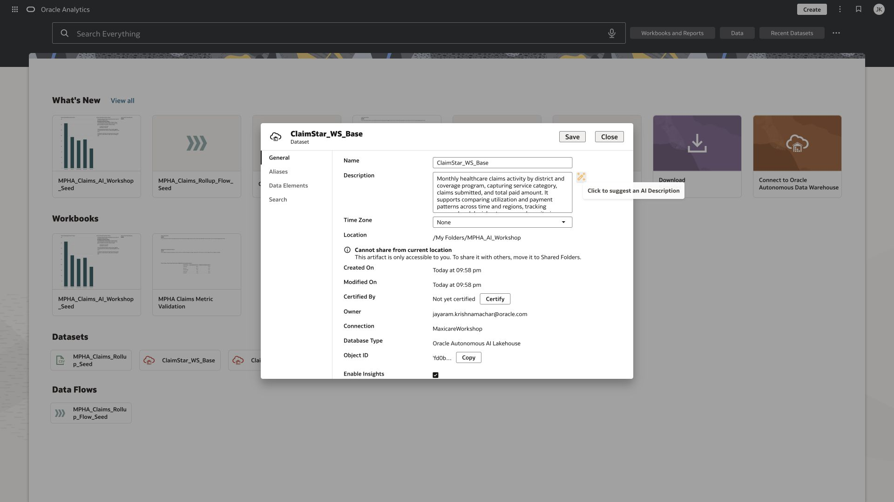

# Lab 2 Generate a catalog description

**Time:** 10 minutes  |  **Rehearsal status:** Verified

A catalog description helps another analyst discover the correct dataset without opening it. This is separate from the field-level AI descriptions in Lab 3.

## Task 1 Generate the description

1. Return to Home. On your ClaimStar_Pxx dataset, select Actions, then Inspect.
2. On General, locate Description and click the wand beside it. Wait for generation to finish; the field may be briefly empty.
3. Read the generated text. Keep a clear statement of monthly claims activity, district and program dimensions, and supported analyses. Remove unsupported claims about patient-level detail, currencies, clinical causation, or real-time data.
4. Click Save. Close and reopen Inspect to confirm the description persisted.

*General inspector for the isolated workshop base before description generation.*

*Actual generated description on the base copy; it was saved during preparation.*

## Checkpoint

Your dataset has a concise catalog description. The source ClaimStar_KJ remains unchanged. The generated text should describe contents and analytical use, not infer a cause of claim denials.

[Oracle documentation for catalog metadata generation](https://docs.oracle.com/en/cloud/paas/analytics-cloud/acubi/add-metadata-dataset-using-ai.html)

[Back to workshop contents](../README.md)
