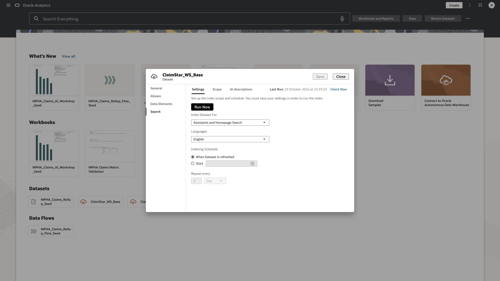
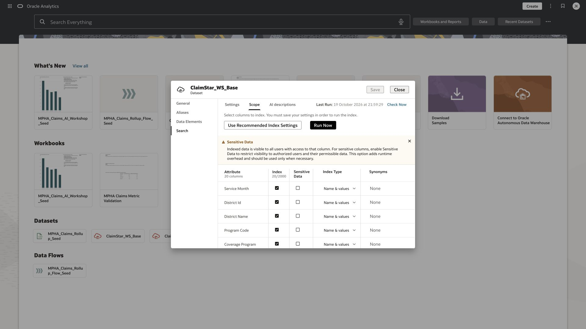
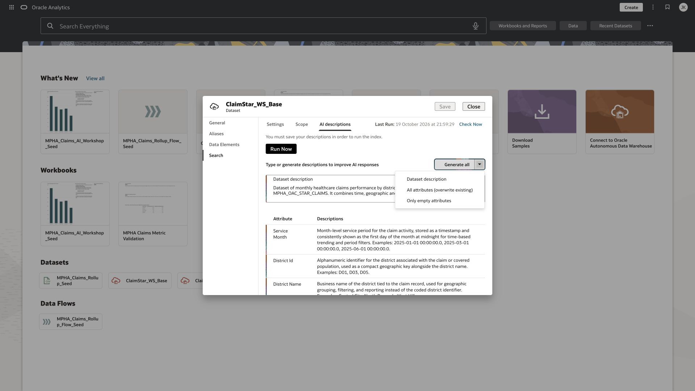
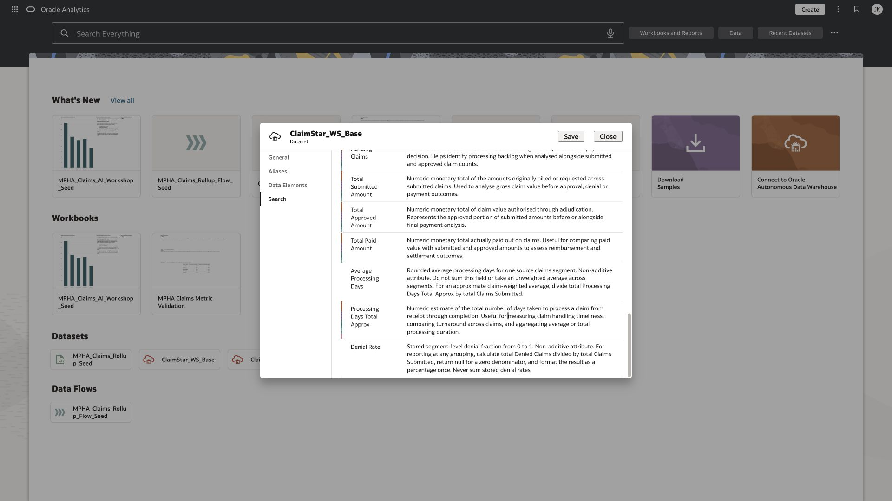
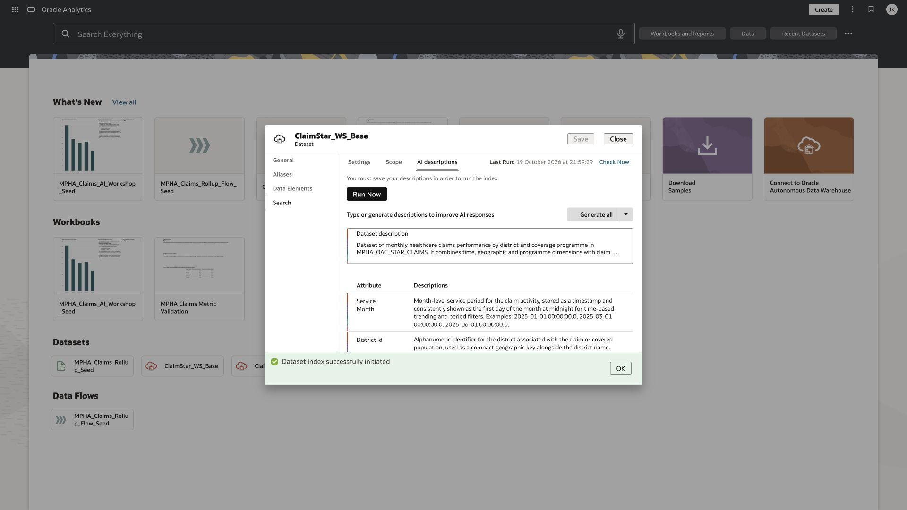

# Lab 3 Enrich the metadata used by AI

**Time:** 10 minutes  |  **Rehearsal status:** Verified

You will inspect AI descriptions, generate a missing field description, correct its grain and aggregation meaning, then refresh the Assistant index. The base reuses the existing source descriptions and adds reviewed guidance for the non-additive metrics.

## Task 1 Inspect the index settings

1. In your dataset Inspector, choose Search, then Settings.
2. Confirm Index Dataset For is Assistants and Homepage Search and language is English. Use the schedule supplied by the facilitator; the rehearsal base uses When Dataset is refreshed.
3. Open Scope. Include the 20 workshop fields, including Processing Days Total Approx. Use Name indexing for numeric measures. Avoid changing Sensitive Data controls as part of this lab.
4. Save changed scope settings before running the index. These steps apply to your copy, not the shared seed.



*Assistant and Homepage Search configuration on the copied dataset.*



*The base scope was expanded from 19 to 20 fields to include the helper.*

## Task 2 Generate only a missing description

1. Open Search, then AI descriptions. Reuse existing useful descriptions rather than replacing all of them.
2. The prepared base already contains the reviewed helper description. In your own ClaimStar_Pxx copy only, copy that description to a scratch note, then clear only the Processing Days Total Approx description to create one empty field for this exercise. Leave the shared base unchanged.
3. Open the arrow beside Generate all and choose Only empty attributes. In rehearsal this generated a description for the newly included Processing Days Total Approx field.
4. Review the generated helper description. The rehearsal output incorrectly described processing time for one claim. That is the wrong grain for this monthly aggregated dataset; your output may differ.
5. Replace or refine it using the reviewed wording below. Confirm Average Processing Days and Denial Rate descriptions also explain their aggregation limits.



*Generate menu with Only empty attributes selected as the intended action.*



*Generated helper text before the grain correction. Review this critically.*

```text
Approximate processing-days numerator for a monthly district-program-claim-classification segment. It equals rounded Average Processing Days multiplied by Claims Submitted. Sum it across segments, then divide by total Claims Submitted for approximate claim-weighted processing days. It is not the elapsed processing time for one claim.
```


*Reviewed metadata after the correction, including the ratio and rounded-mean guidance.*

## Task 3 Save and reindex

1. Click Save and wait for it to complete.
2. Click Run Now. A confirmation that indexing was initiated is not proof that it has completed.
3. Acknowledge the initiation message. Refresh the index status later and confirm the Last Run time advances. Before the workshop, the facilitator must also test a simple workbook prompt against the released base.
4. During the workshop, do not repeatedly click Run Now. If indexing is slow, use the already indexed base to continue the workbook lab.



*OAC confirmation that the reviewed dataset index was initiated.*

## Checkpoint

Your metadata distinguishes a segment-level ratio, a rounded segment mean, and the weighted numerator. You understand why good descriptions improve interpretation but do not guarantee a correct answer.

[Oracle documentation for AI descriptions](https://docs.oracle.com/en/cloud/paas/analytics-cloud/acubi/add-ai-descriptions-dataset.html)

[Oracle documentation for indexing a dataset](https://docs.oracle.com/en/cloud/paas/analytics-cloud/acubi/indexing-dataset-oracle-analytics-ai-assistant.html)

[Back to workshop contents](../README.md)
