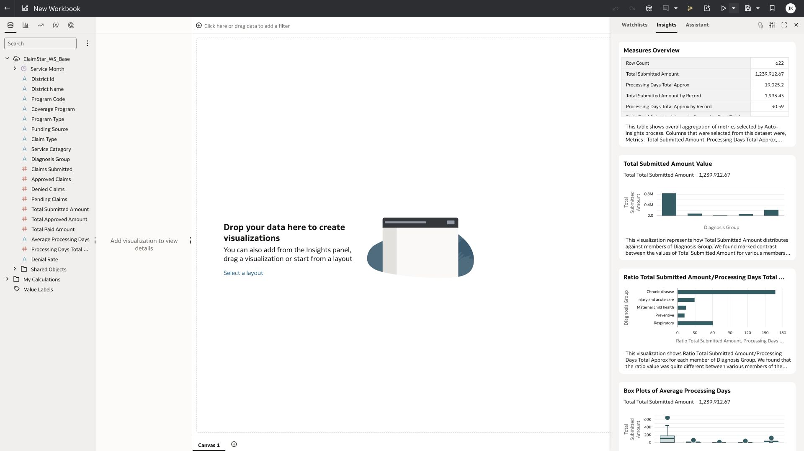
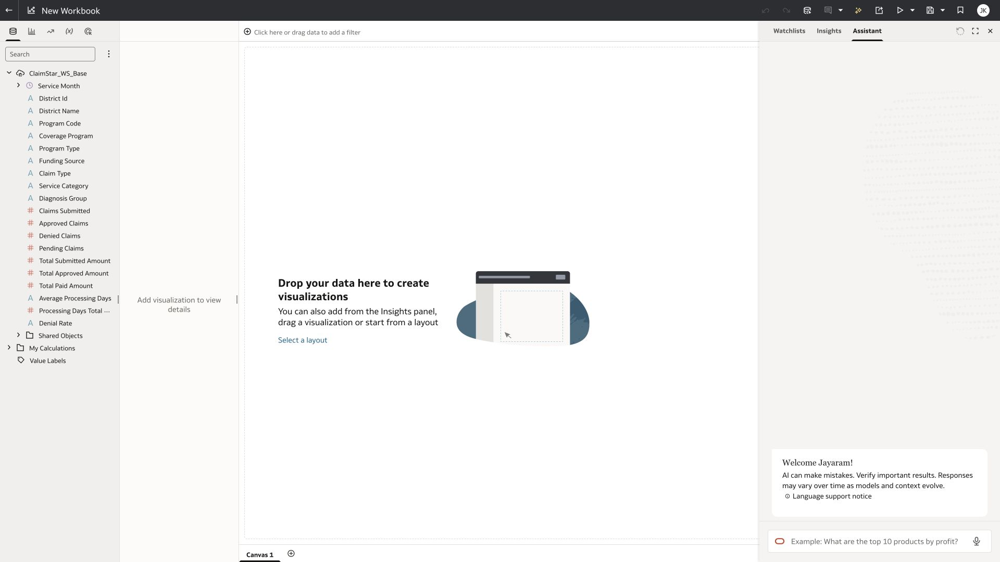
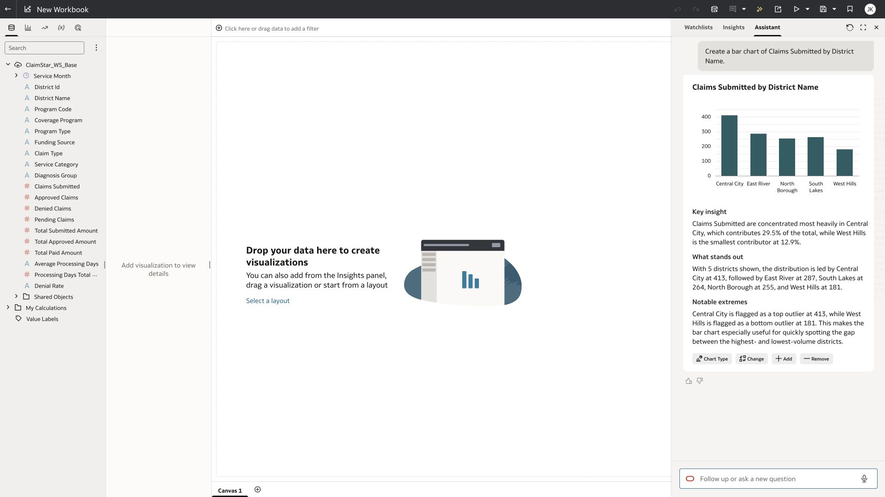
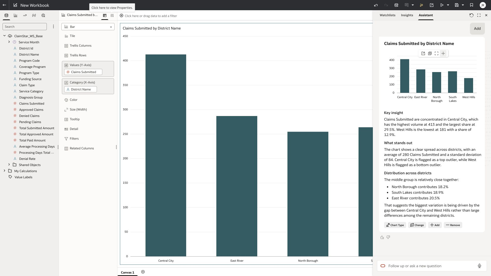
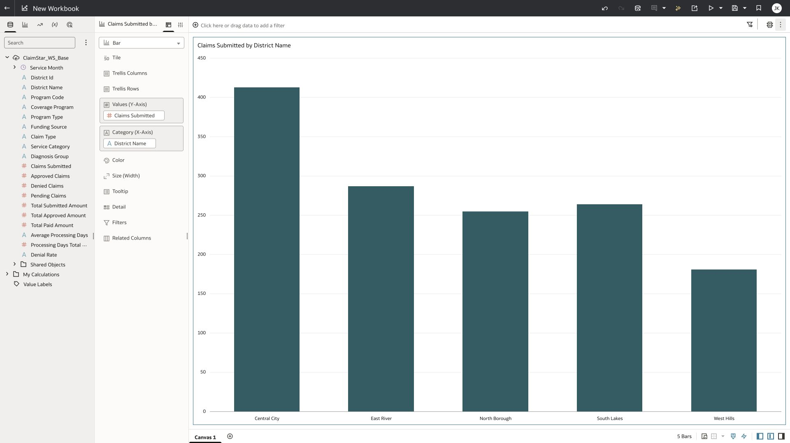
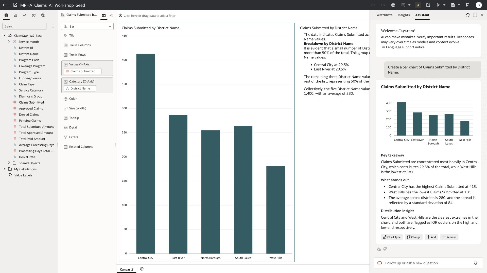

# Lab 4 Build a chart with Workbook Assistant

**Time:** 20 minutes  |  **Rehearsal status:** Verified

You will ask a concrete business question, inspect the generated chart and explanation, and add the chart to your canvas. The rehearsal base returned district volumes that reconcile to 1,400 claims.

## Task 1 Open Assistant

1. Open your dataset and click Create Workbook. Alternatively, choose Create Workbook from the dataset card Actions.
2. Click Auto Insights to show the drawer if it is closed, then choose Assistant. The toolbar button toggles the drawer: check the screen before clicking again.
3. Wait for the Assistant status check. If indexing is still in progress, follow the facilitator’s fallback to the indexed seed.
4. Use typed English prompts. The rehearsal profile displayed a language support notice; do not change profile settings during the lab.



*New workbook created from the isolated dataset.*



*Assistant panel ready for a typed question.*

## Task 2 Generate and verify the chart

```text
Create a bar chart of Claims Submitted by District Name.
```

1. Paste the prompt in the Assistant input and press Enter. Wait until the chart and explanatory text have both appeared.
2. Confirm it uses the count Claims Submitted, summed by District Name. A row count would count 622 segments and answer a different question.
3. Check the district values against the table below. Check that all five districts are present.
4. Review the prose separately from the chart. Terms such as outlier are Assistant interpretations and should not be treated as a demonstrated statistical test.



*Actual generated district claims chart and explanation.*

| District | Claims Submitted | Share |
| --- | --- | --- |
| Central City | 413 | 29.50% |
| East River | 287 | 20.50% |
| North Borough | 255 | 18.21% |
| South Lakes | 264 | 18.86% |
| West Hills | 181 | 12.93% |
| Total | 1,400 | 100% |

## Task 3 Add the visualization and save

1. Hover over the generated chart to reveal its chart toolbar. Click Add to Canvas on that toolbar.
2. Do not confuse Add to Canvas with the Add suggestion button below the response. That button helps compose a follow-up prompt; it does not place the chart on the canvas.
3. Close the Assistant drawer and confirm the chart is on Canvas 1.
4. Save the workbook as Claims_AI_Pxx in your own folder. Check the workbook title after saving.



*Generated chart action used to add the visualization to the canvas.*



*The chart on the workbook canvas before the calculation and narrative labs.*

## Checkpoint

Claims_AI_Pxx contains a five-district chart with a total of 1,400 claims. Recovery: open MPHA_Claims_AI_Workshop_Seed and use Save As with your participant name.

The prepared base was tested again after the reviewed metadata and latest index refresh: the district chart prompt returned successfully in the saved workbook. This verifies the facilitator base; each released participant copy still needs its own access and index check.



*Successful district chart response after the final metadata refresh, with the saved workbook visible behind the drawer.*

[Oracle documentation for Workbook Assistant](https://docs.oracle.com/en/cloud/paas/analytics-cloud/acubi/generate-visualizations-workbooks-oracle-analytics-ai-assistant.html)

[Back to workshop contents](../README.md)
