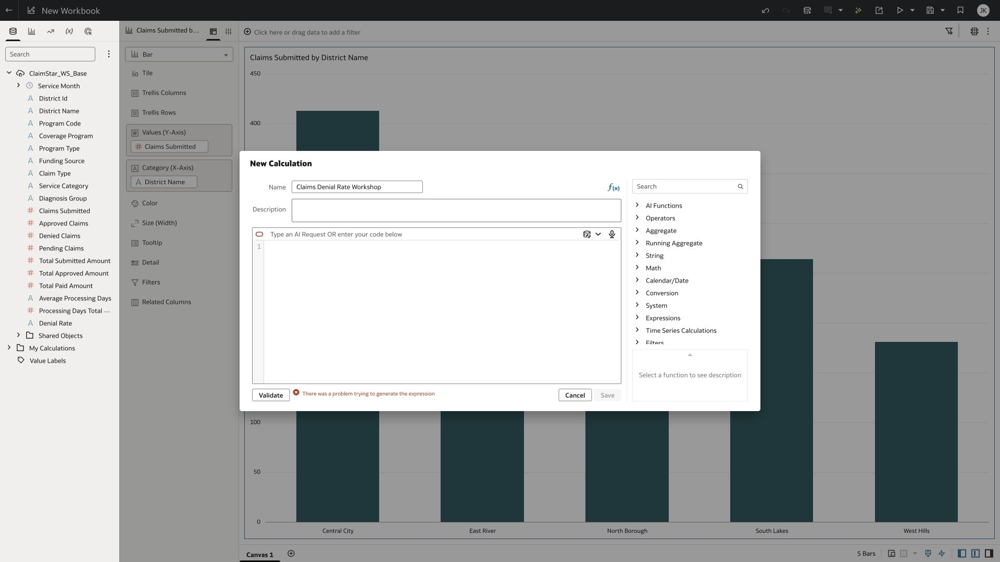

# Lab 5 Validate a denial-rate calculation

**Time:** 15 minutes  |  **Rehearsal status:** AI error with verified fallback

You will request an aggregate expression, inspect it, and validate the denominator logic. In this tenant, Expression Assistant returned a generation error in rehearsal, including after explicit dataset selection and simpler prompts. The manual route below was validated and produced the expected 8.64% KPI.

## Task 1 Try Expression Assistant

1. In the workbook Data panel, open its Menu and select Create Calculation.
2. Name the calculation Claims Denial Rate Workshop. If several datasets are present, choose your intended dataset using Pick dataset beside the Assistant input.
3. Enter the prompt below in the Assistant box and press Enter. Allow the request to finish.
4. If generation succeeds, inspect the entire expression. If OAC displays the captured generation error, move to Task 2 after one retry. Do not spend the whole timebox retrying.

```text
Calculate the ratio of total Denied Claims to total Claims Submitted. Return NULL when total Claims Submitted is zero. Use a ratio from 0 to 1, not multiplied by 100.
```


*Expression Assistant request in the calculation editor.*



*Actual tenant generation error. This is a known rehearsal limitation, not a successful AI output.*

## Task 2 Use and validate the fallback

1. Create the formula below in the Expression editor. Insert each field from Data Elements, or use autocomplete if shown; the field references must be fully qualified.
2. If you need to construct the reference explicitly, open your dataset Actions → Inspect → General in a second tab and copy Object ID. It contains the namespace and dataset name. In the supplied formula file replace the entire rehearsal object ID with your own copied ID, keeping XSA(...), the table MPHA_OAC_STAR_CLAIMS, and the field names.
3. Do not paste bare field names such as SUM("Denied Claims"). OAC rejected that form because the dataset and table paths were missing.
4. Click Validate. Continue only when OAC reports Calculation validated, then click Save.
5. Recovery: Save As the prepared workbook as Claims_AI_Pxx. Its existing calculation refers to the prepared base dataset and already produces 8.64%. Do not change its object ID unless you also replace its data source.

```text
CASE WHEN SUM(<Claims Submitted token>) = 0 THEN NULL
ELSE 1.0 * SUM(<Denied Claims token>) / SUM(<Claims Submitted token>) END
```


*The fully qualified fallback expression passed OAC validation.*

## Task 3 Create the KPI

1. Under My Calculations, right-click Claims Denial Rate Workshop and select Create Best Visualization.
2. Select the new tile. Open Properties, then Values, expand the calculation, and change Value from Auto to Percent. Keep two decimal places.
3. Confirm the total displays 8.64%. This is 121 divided by 1,400, formatted as a percentage once.
4. Save Claims_AI_Pxx. Optionally repeat the calculation using SUM(Processing Days Total Approx) divided by SUM(Claims Submitted), guarded for zero. Label it Weighted Processing Days Approx; the expected total is approximately 13.59 days.


*Percent formatting and the 8.64% aggregate denial-rate checkpoint.*

## Checkpoint

The calculation is validated and the tile displays 8.64%. Changing to district grain must recompute the ratio of totals. Never use SUM(Denial Rate).

[Oracle documentation for Expression Assistant](https://docs.oracle.com/en/cloud/paas/analytics-cloud/acubi/compose-expressions.html)

[Back to workshop contents](../README.md)
