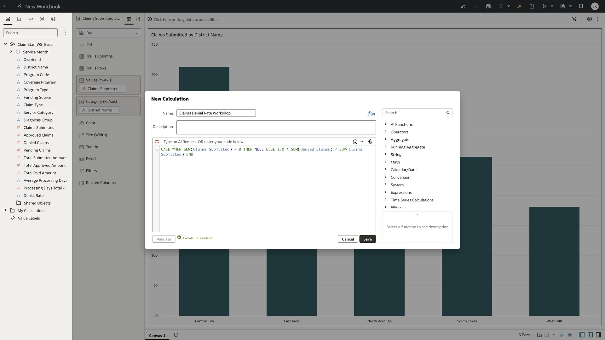
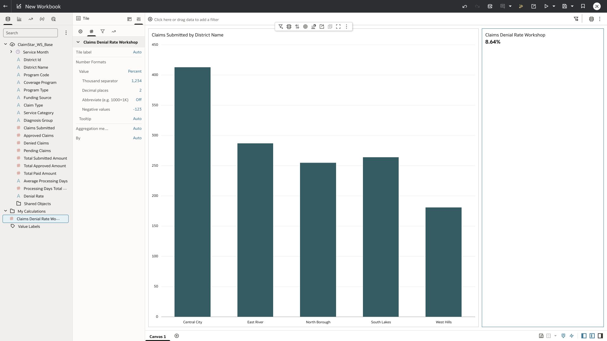

# Exercise 6: create and validate the aggregate denial-rate KPI

10 minutes · Verified: fully qualified calculation validates and displays 8.64%

Create the guarded ratio directly in the calculation editor, using the path that was successfully validated. The result is a native OAC calculation, reused by the KPI and later dashboard checks.

> Compute the KPI from summed claim counts. The stored segment Denial Rate is non-additive and must not be summed.

## Task 1 Create and validate the calculation

1. In the Data panel, choose Add Calculation from the menu beside the data-source search box. Name it Claims Denial Rate Workshop.
2. Build the CASE expression below. Insert Claims Submitted and Denied Claims from Data Elements so OAC supplies the fully qualified dataset and table references. Replace the angle-bracket labels with inserted field tokens; do not paste the labels as literal SQL.
3. Click Validate. Continue when OAC reports Calculation validated, then click Save. The prepared workbook contains the validated expression if you need to inspect a completed example.

```text
CASE WHEN SUM(<Claims Submitted token>) = 0 THEN NULL
ELSE 1.0 * SUM(<Denied Claims token>) / SUM(<Claims Submitted token>) END
```



## Task 2 Create the KPI

1. Under My Calculations, right-click Claims Denial Rate Workshop and select Create Best Visualization.
2. Select the new tile. Open Properties, then Values, expand the calculation, and change Value from Auto to Percent. Keep two decimal places.
3. Confirm the total displays 8.64%. This is 121 divided by 1,400, formatted as a percentage once.
4. Save Claims_AI_Pxx. The optional approximate weighted-days calculation needs Processing Days Total Approx from the prepared 20-field base; omit it on the 19-field participant source.



## Checkpoint

The calculation is validated and the tile displays 8.64%. Changing to district grain must recompute the ratio of totals. Never use SUM(Denial Rate).

[Oracle documentation for Expression Assistant](https://docs.oracle.com/en/cloud/paas/analytics-cloud/acubi/compose-expressions.html)
