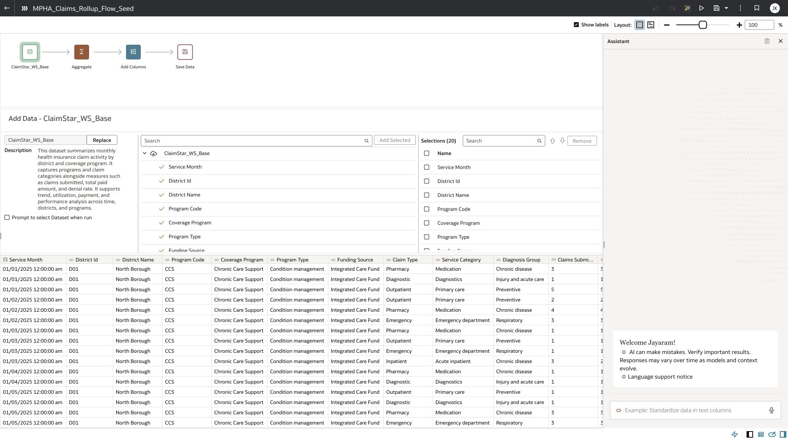
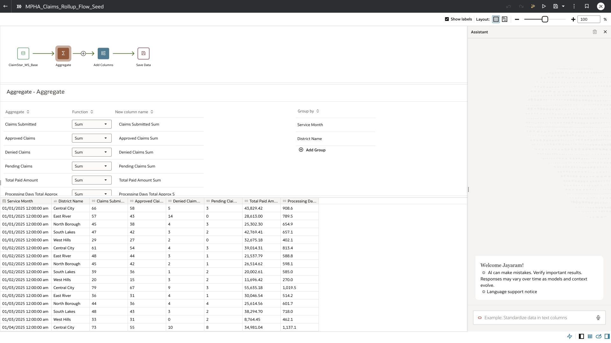
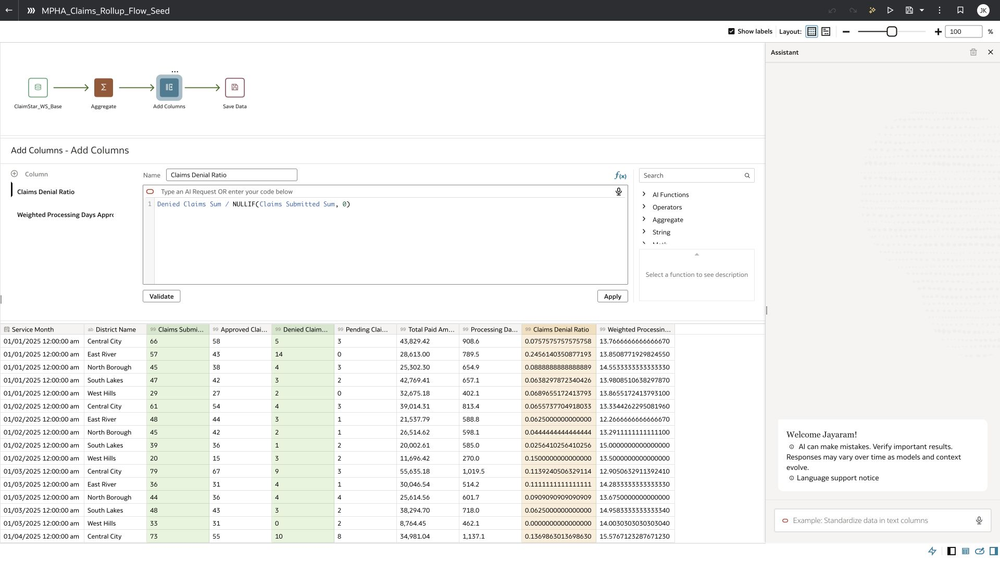
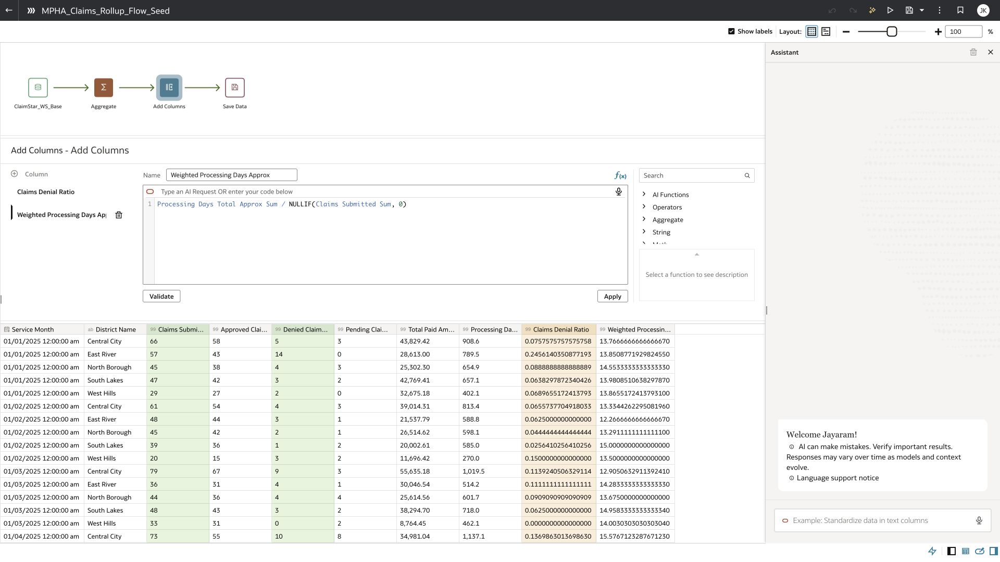
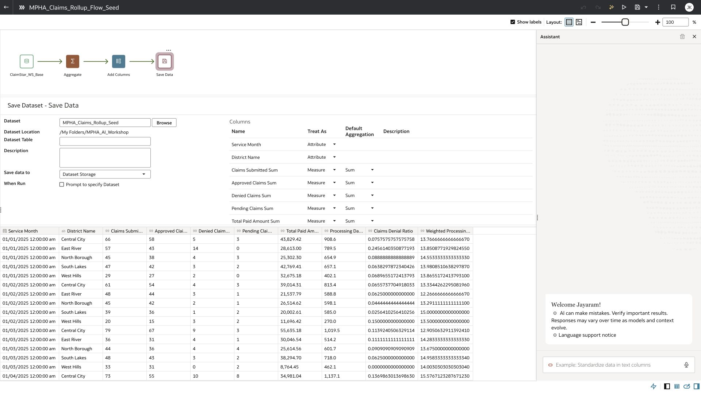
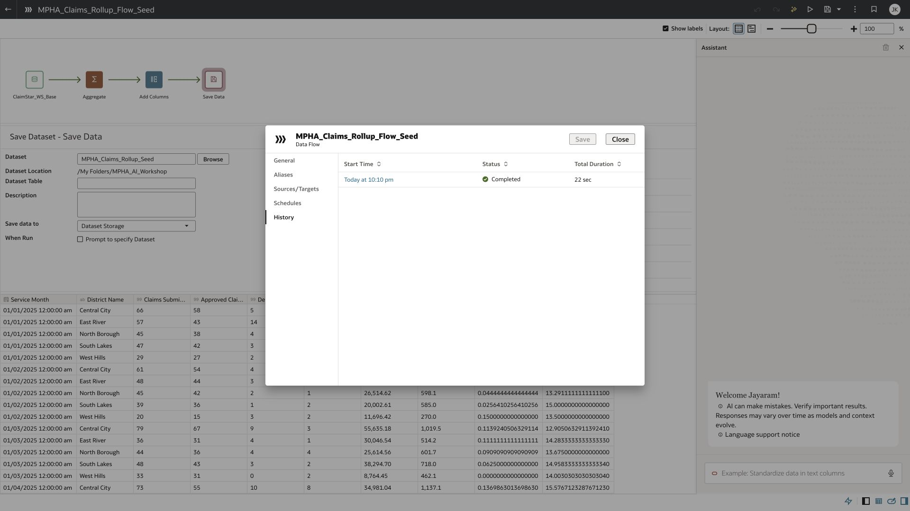
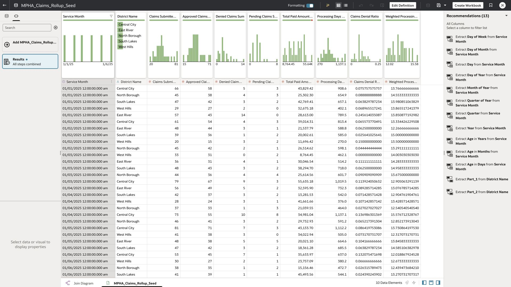

# Lab 6 Build and run a rollup with Data Flow Assistant

**Time:** 25 minutes  |  **Rehearsal status:** Verified

You will turn 622 claims segments into 30 district-month rows and recompute ratios after aggregation. The prepared MPHA_Claims_Rollup_Flow_Seed completed in 22 seconds in this rehearsal. That is an observation from one run, not a concurrency or response-time guarantee.

## Task 1 Create the flow and input

1. At Home, choose Create, then Data Flow. Select your ClaimStar_Pxx dataset and click Add.
2. Save the draft as Claims_Rollup_Flow_Pxx in your own folder.
3. Open Assistant on the flow toolbar. If it is absent, the facilitator must enable both Data Flow AI preview switches before the event. After activation, allow time for propagation and refresh the saved flow.
4. Keep one participant’s flow per name. Do not edit the shared seed or run all 20 flows simultaneously.



*Prepared flow with its input selected. The other nodes are the completed reference; a new participant flow initially has only the input.*

## Task 2 Generate the aggregation

```text
Aggregate the data by Service Month and District Name. Sum Claims Submitted, Approved Claims, Denied Claims, Pending Claims, Total Paid Amount, and Processing Days Total Approx. Exclude other columns.
```

1. Enter the prompt in Assistant and press Enter. In rehearsal the Assistant added an Aggregate step directly to the flow.
2. Select Aggregate and verify exactly two grouping fields: Service Month and District Name.
3. Verify exactly six aggregate fields and that every function is Sum. The output names in rehearsal end with Sum, as shown.
4. Check the preview. Do not aggregate Denial Rate or Average Processing Days. If the Assistant makes a different selection, correct it before continuing.



*Verified Aggregate step with six sums and the two grouping fields.*

## Task 3 Generate derived fields after aggregation

```text
Add two columns: Claims Denial Ratio equals Denied Claims Sum divided by Claims Submitted Sum. Weighted Processing Days Approx equals Processing Days Total Approx Sum divided by Claims Submitted Sum. For both columns return null when Claims Submitted Sum is zero. Keep all existing columns.
```

1. Submit the derived-fields prompt. Select the generated Add Columns node.
2. Inspect Claims Denial Ratio. The tested expression uses Denied Claims Sum / NULLIF(Claims Submitted Sum, 0).
3. Inspect Weighted Processing Days Approx. The tested expression uses Processing Days Total Approx Sum / NULLIF(Claims Submitted Sum, 0).
4. Confirm both expressions use aggregated output columns and protect zero denominators. Keep the existing eight rollup columns as well as the two new ones.



*Generated ratio expression after the aggregation.*



*Generated approximate weighted-processing expression.*

## Task 4 Save the output and execute

```text
Save the result to a new Oracle Analytics dataset named Claims_Rollup_Pxx.
```

1. Submit the output prompt using your participant ID. Inspect Save Data: Save data to must be Dataset Storage for this exercise.
2. Verify the output name is unique and click Save on the flow toolbar. This saves the flow definition.
3. When the facilitator calls your wave, click Run Data Flow once. Saving the definition alone does not create the output.
4. Open the flow Page Menu, Inspect, then History. Wait for Completed. If a run fails, open its details before retrying; do not repeatedly submit it.



*Prepared Save Dataset node uses Dataset Storage. Participants must replace the seed output name with Claims_Rollup_Pxx.*



*Actual flow run history showing Completed and a 22-second duration.*

## Task 5 Reconcile the output

1. At Home, locate your output dataset and select Open. Confirm it has 30 rows and 10 columns.
2. Check the six totals against Lab 0. The supplied checkpoints/MPHA_Claims_Rollup_Seed.csv was downloaded from the completed OAC output and independently reconciled.
3. Check one row: January, Central City has 66 submitted, 58 approved, 5 denied, 3 pending, 43,829.42 paid, and 908.6 approximate processing-days numerator.
4. For that row, confirm 5/66 = 0.075757… and 908.6/66 = 13.766666… . Do not sum or average the 30 output ratios for an overall KPI; recompute from the six summed measures.



*Actual output dataset with 30 rows and 10 columns.*

> Concurrency plan: P01–P05 run first, P06–P10 second, P11–P15 third, and P16–P20 fourth. Start the next wave when the previous one completes. All groups can review expressions while waiting. Use the prepared CSV if a participant run cannot complete inside the timebox.

[Oracle documentation for Data Flow Assistant preview](https://docs.oracle.com/en/cloud/paas/analytics-cloud/acubi/use-ai-assistant-create-data-flows.html)

[Oracle documentation for running data flows](https://docs.oracle.com/en/cloud/paas/analytics-cloud/acubi/generate-or-update-dataset-using-data-flow.html)

[Back to workshop contents](../README.md)
