# Optional final demo: Semantic Modeler Assistant in Industry Analytics

Optional · 15 minutes · Verified instructor demo · Industry Analytics

> Time permitting only, after all core analytics and MCP work. Allow an additional 15 minutes or use as a follow-up demo; the 180-minute completion gate does not require it. The instructor uses Industry Analytics / semmodel. Participants stay in their hands-on environment.

Delivery choice agreed with the workshop owner: the instructor demonstrates Semantic Modeler in Industry Analytics; participants watch and remain in their existing workshop accounts. The seven other feature labs retain their hands-on format. This slot demonstrates AI-assisted naming and descriptions on a prepared claims model. Building all three layers is facilitator preparation outside the 15-minute slot.

> Verified on 20 October 2026: completed model save/reopen, seven applied fact-column name suggestions, table and column description generation, live physical source preview, and all-object consistency with warnings included: zero errors and zero warnings. The model is private and undeployed. No shared Industry Analytics runtime was replaced. A sampled source preview does not prove full ORIGAMI_P01 totals or parity with ClaimStar_KJ.

| Object | Prepared value |
| --- | --- |
| Instance | Industry Analytics — instructor only |
| Model | MPHA_Claims_Semantic_Demo |
| System connection / schema | semmodel / ORIGAMI_P01 |
| Physical database | MPHA_AILH |
| Business model | MPHA Claims |
| Presentation subject area | MPHA Claims Workshop Demo |
| Reporting measures | Seven SUM counts/amounts and guarded Claims Denial Ratio |
| Scope boundary | Weighted duration remains in the other hands-on labs; it is not exposed in this semantic starter. |

[Open the prepared Industry Analytics model](https://industryanalytics-apaccpt01-78-fr.analytics.ocp.oraclecloud.com/ui/dv/?artifactid=ea90db2a-459e-4d03-8500-a48bec8ba68c&pageid=semanticmodelerworkspace&workspacegitstate=notEnabled&workspacename=MPHA_Claims_Semantic_Demo)

## Task 1 Switch environments and orient the audience — minutes 0–2

1. Presenter: switch to the bookmarked Industry Analytics model tab. State that this is the instructor demo instance; participants keep their original OAC workshop tab open.
2. If starting from Home, choose Navigator → Semantic Models → MPHA_Claims_Semantic_Demo. The completed model has been closed and reopened successfully.
3. Explain the three layers: Physical identifies database objects and joins; Logical defines business measures; Presentation supplies the folders and descriptions that analysts consume.

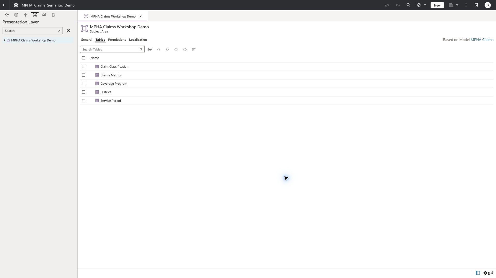

## Task 2 Tour the prepared star and measure rules — minutes 2–4

1. In Physical Layer, open MPHA_AILH → Tables. Show the fact and four dimensions and the four Many to One Inner joins. Point out the differently named service-month date key.
2. In Logical Layer, open MPHA Claims → Claims Metrics → Columns. Show the seven additive measures using Sum and the guarded logical Claims Denial Ratio.
3. Explain that a stored segment denial rate cannot be summed. The reporting ratio uses the already aggregated Denied Claims and Claims Submitted. The starter intentionally excludes stored AVG_PROCESSING_DAYS and DENIAL_RATE from its presentation fact folder.

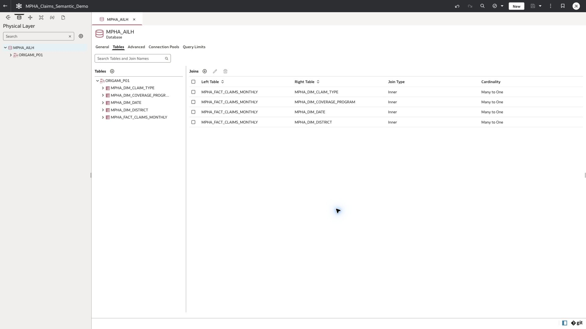

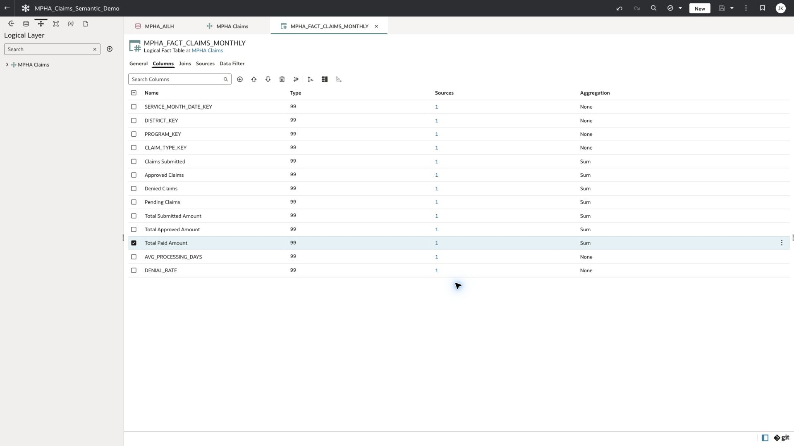

## Task 3 Generate business names live — minutes 4–8

1. Open Logical Layer → MPHA Claims → Claim Classification → Columns → Rename Columns. These dimension columns were deliberately left with raw source names so this live exercise is repeatable from the supplied starter.
2. Click Suggest Names and wait for generation to finish. In rehearsal: CLAIM_TYPE became Claim Type, SERVICE_CATEGORY became Service Category, DIAGNOSIS_GROUP became Diagnosis Group, and CLAIM_TYPE_KEY became Claim Type ID. Results may vary.
3. Clear the checkbox for CLAIM_TYPE_KEY. Explain why identifier meaning and source mappings need human review. For this replay, review the three business names and click Cancel so the starter remains ready for another demonstration.
4. Show the applied fact-name example below. The seven fact measures were actually renamed and saved during preparation. If showing Apply live is essential, use a separate imported rehearsal copy and apply only the three selected dimension names, save, and check presentation mappings before reusing that copy.

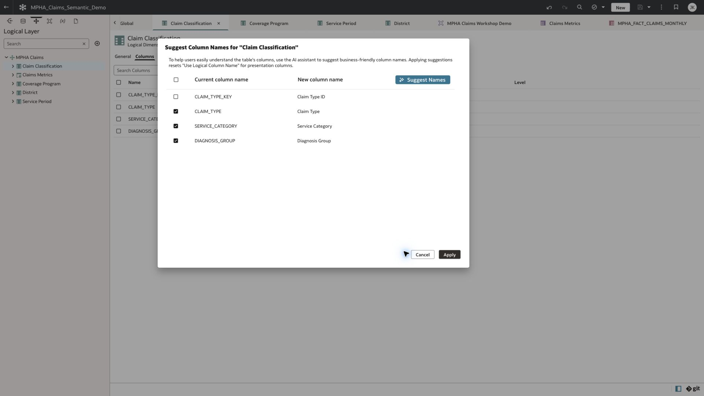

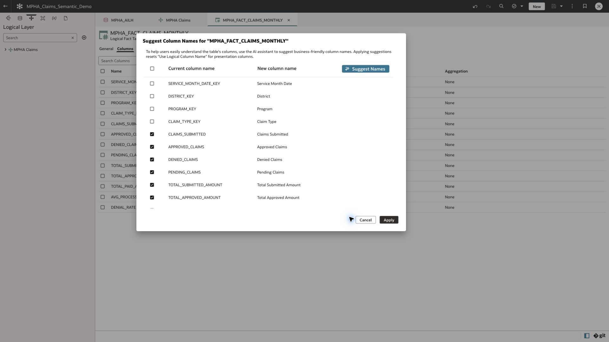

## Task 4 Generate and review a table description — minutes 8–10

1. Open Presentation Layer → MPHA Claims Workshop Demo → Claims Metrics → General.
2. Copy the current reviewed description to a local rehearsal note before changing it. Click Generate Description. A second generation may display an overwrite prompt; accept only when working on the private demo copy.
3. Read the generated text. During rehearsal it described submission, approval, denial, financial amounts and denial ratios. Add the grain, aggregation rule, unspecified currency and operational scope using the reviewed text below.
4. Save, wait for success, and verify the saved text. AI generation is a drafting step; the presenter owns the meaning.

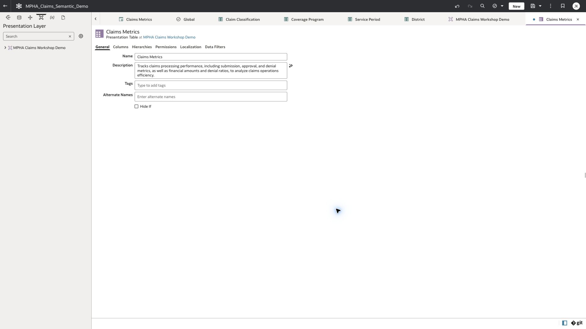

```text
Tracks claims submissions, approvals, denials, pending counts, monetary totals and denial ratio. Grain: service month, district, coverage program and claim type. Counts and amounts use SUM; Claims Denial Ratio divides aggregated denied by aggregated submitted and returns NULL for a zero denominator. Currency is unspecified. Claims operations only; no patient-level clinical outcomes.
```

## Task 5 Generate a measure description — minutes 10–12

1. In the same presentation table choose Columns, switch on Detail view, and select Claims Denial Ratio.
2. Click Generate Description beside Description. The tested output correctly described denied/submitted and returning null when no claims were submitted.
3. Review the output and replace it with the approved wording below before saving. This keeps the aggregate meaning and formatting convention explicit.

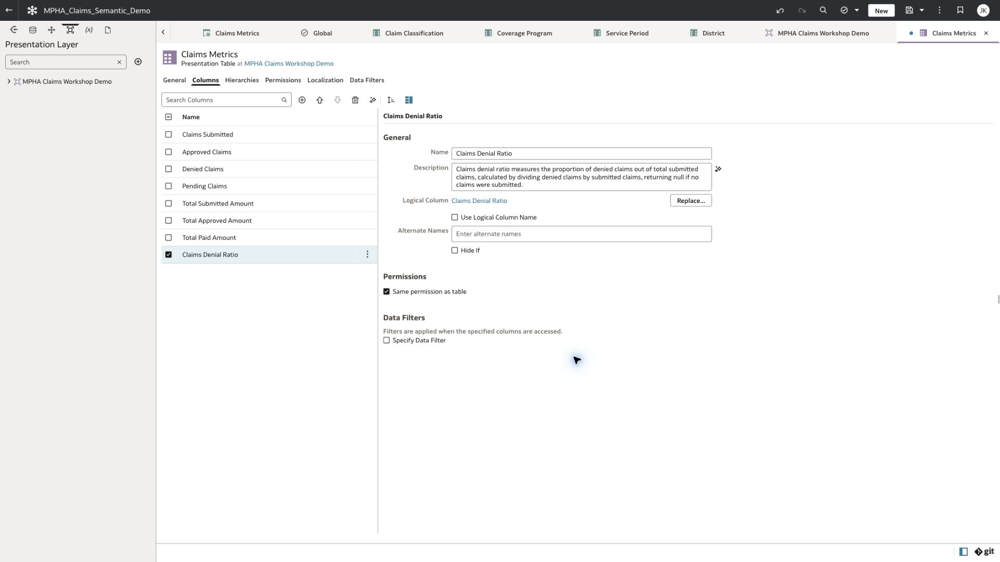

```text
Claims denial ratio is aggregated denied claims divided by aggregated submitted claims. Returns NULL if no claims were submitted. Stored as a fraction; format as a percentage. Do not sum or average stored segment rates.
```

## Task 6 Validate, prove persistence and return — minutes 12–15

1. Open Check Consistency menu → Include warnings. Run Check Consistency; if the Global results pane is already open, click its Check icon to rerun. Wait for the new result, because an earlier result can remain visible while the check runs.
2. Show Errors (0), Warnings (0) and Hidden Warnings (0). Consistency checks metadata; it does not prove deployed query results, source completeness or permissions.
3. Save, use Go back, reopen the model from Semantic Models, and open the Claims Denial Ratio description. The screenshot below records the successful completed-model reopen.
4. Ask the audience: why is SUM(Denied Claims)/SUM(Claims Submitted) different from SUM(segment denial rates)? Then switch back to the original workshop OAC tab for Lab 8. No participant login to Industry Analytics is needed.

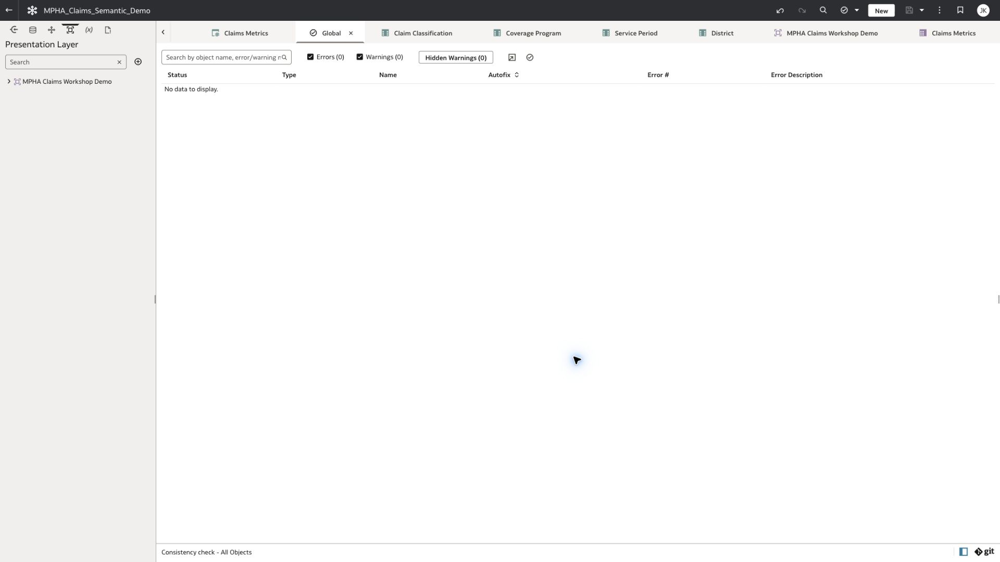

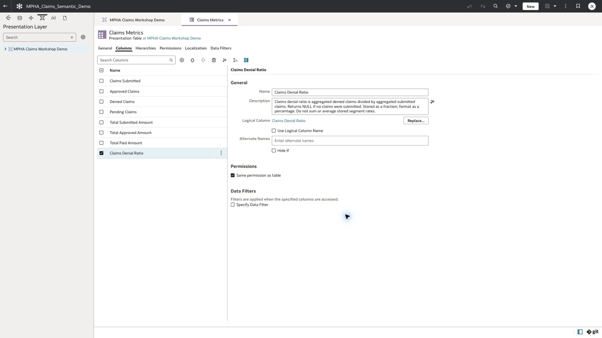

## If a live AI request stalls

Allow one bounded retry, then show the matching real screenshot above and explain its reviewed result. Do not spend the remaining workshop time troubleshooting generation. A naming preview can be canceled; restore the approved table and column wording after a description demonstration. Use a private imported copy for destructive practice. Keep the working model available as the recovery point.

## Facilitator preparation A — initialize and import before the event

1. In Industry Analytics choose Navigator → Semantic Models → Create. Name the private model MPHA_Claims_Semantic_Demo or a unique rehearsal name. Choose Start with Empty Model.
2. Create a physical database called MPHA_AILH, add the description and save. Leave and reopen it before importing to establish that persistence works. This gate passed in Industry Analytics.
3. Open Connections and locate the existing System connection semmodel. Expand Schemas → ORIGAMI_P01 and identify the five claims tables. Do not create another credential or alter the existing connection.
4. In Physical Layer open MPHA_AILH → Tables → Add Database Object (+) → Add Table. Select the five tables individually using Command-click on macOS or Ctrl-click on Windows. Verify an actual tick beside every table. A Shift-highlighted range imported only its two endpoints during rehearsal.
5. Confirm all five actual table selections in the import dialog, then add them. Accept the database-type alignment to Oracle Autonomous AI Lakehouse when prompted. Verify the final five-table list and save.

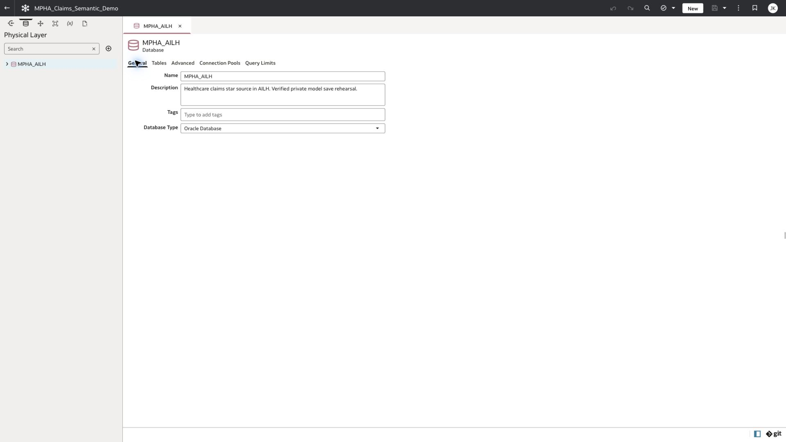

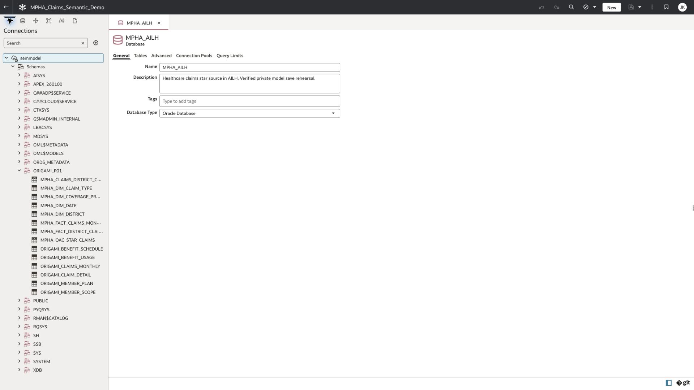

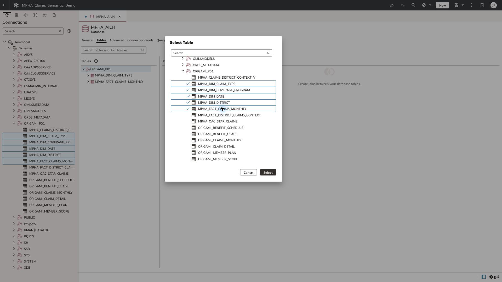

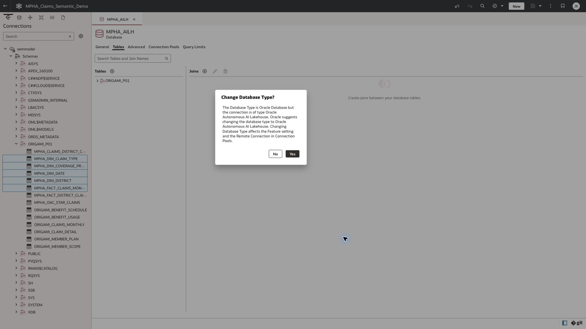

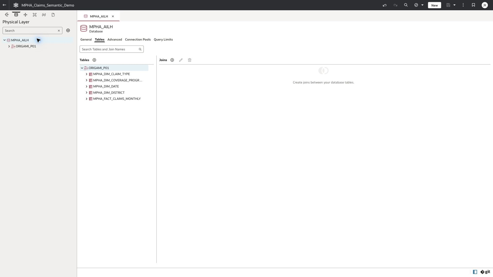

## Facilitator preparation B — explicit joins and logical measures

| Left fact column | Right dimension column | Join settings |
| --- | --- | --- |
| SERVICE_MONTH_DATE_KEY | MPHA_DIM_DATE.DATE_KEY | Many to One / Inner |
| DISTRICT_KEY | MPHA_DIM_DISTRICT.DISTRICT_KEY | Many to One / Inner |
| PROGRAM_KEY | MPHA_DIM_COVERAGE_PROGRAM.PROGRAM_KEY | Many to One / Inner |
| CLAIM_TYPE_KEY | MPHA_DIM_CLAIM_TYPE.CLAIM_TYPE_KEY | Many to One / Inner |

1. In database Tables use Joins → Add Join (+). Open the Left Table arrow, search MPHA_FACT_CLAIMS_MONTHLY, and select the result. Open Right Table, search the required dimension, and select it.
2. Choose the matching Left Column and Right Column from the table above. Add each join, verify its name and cardinality in the four-row join list, then Save.
3. Choose Logical Layer → Create (+) → Create Business Model. Enter MPHA Claims and an operational claims description. On Logical Tables use Facts → Add Table → Add Table and select the physical monthly claims fact.
4. Use Dimensions → Add Table → Add Table. Search MPHA_DIM_, Command/Ctrl-click the four dimension rows, and Select. Rehearsal created all four logical dimensions and inherited the four joins. Verify the final lists; visual selection alone is insufficient.
5. Rename the logical fact Claims Metrics and the dimensions Claim Classification, Coverage Program, Service Period and District. On General verify their imported primary keys: CLAIM_TYPE_KEY, PROGRAM_KEY, DATE_KEY and DISTRICT_KEY respectively. Save each refactoring; choose Save All if prompted before navigation.
6. Open fact Columns → Rename Columns → Suggest Names. Apply only Claims Submitted, Approved Claims, Denied Claims, Pending Claims, Total Submitted Amount, Total Approved Amount and Total Paid Amount. Leave source keys and the two segment statistics unchanged.
7. For each of the seven additive measures double-click Aggregation, choose Sum, then press Enter to commit the row. Recheck the displayed value after editing. Do not leave the inline editor open when saving.

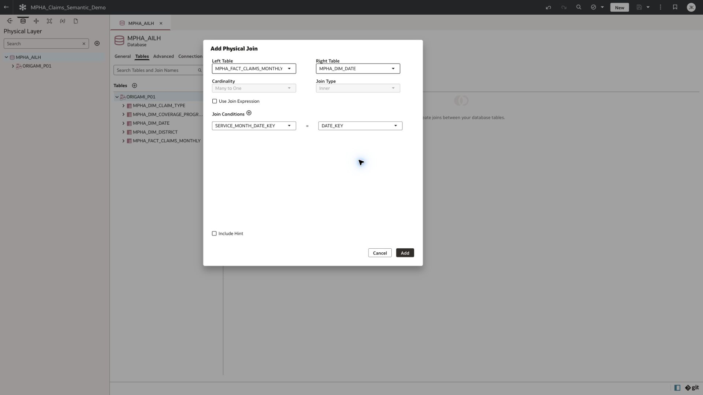

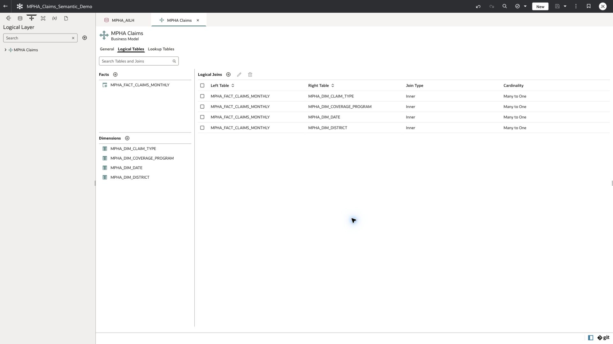

1. In Claims Metrics → Columns → Add Column → Create New Column, enter Claims Denial Ratio and press Enter. Switch on Detail view, select the new column, and choose Logical Expression.
2. Click Open Expression Editor. Insert real column tokens by expanding Claims Metrics and double-clicking Claims Submitted and Denied Claims. Compose the expression below with these tokens; typing a plain three-part quoted name did not resolve in this editor.
3. Click Validate and require Calculation validated. Click Save in the expression editor, add the reviewed logical description, and save the model. Do not edit the read-only formula preview as though it were the expression editor.

```text
CASE WHEN <Claims Submitted token> = 0 THEN NULL
ELSE 1.0 * <Denied Claims token> / <Claims Submitted token> END
```

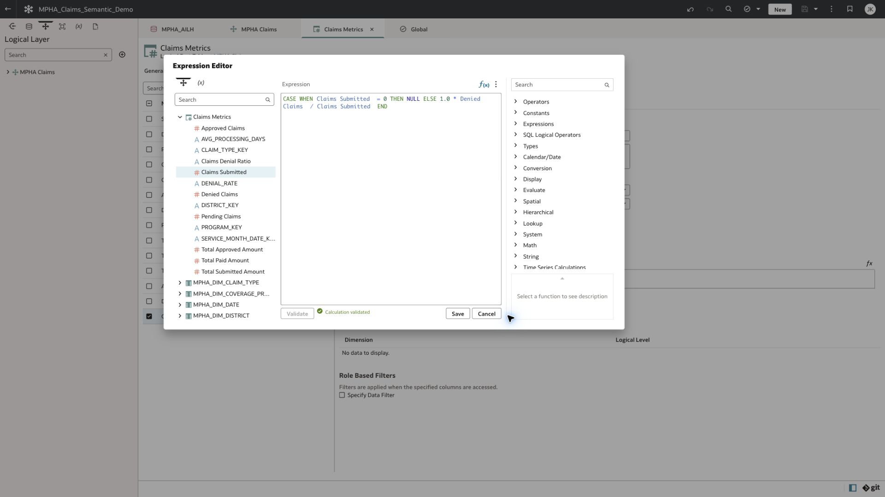

## Facilitator preparation C — presentation, rehearsal and reset

1. Choose Presentation Layer → Create (+) → Create Subject Area. Name it MPHA Claims Workshop Demo, select MPHA Claims as Business Model, and click OK.
2. On Tables use Add Table (+) → Add Tables. Command/Ctrl-click the five logical tables and Select. Verify all five presentation folders.
3. Open presentation Claims Metrics → Columns. Select the four technical keys plus AVG_PROCESSING_DAYS and DENIAL_RATE, then Delete and confirm. This removes presentation references only; retain their physical and logical source columns. Verify exactly the eight reporting measures listed in the model inventory.
4. Run the naming and both description-generation exercises above. Leave Claim Classification raw names unchanged after the naming preview so the live demo starts from the same state. Keep the approved final table and column descriptions saved.
5. Run consistency with warnings included, then close and reopen the completed model. The exported SMML in checkpoints/industry-semantic-model is an independently inspected record of the saved definitions.
6. Use Page Menu → Export → Archive File (.zip) for a fresh private backup. Save to a local folder and verify the archive. Do not include wallets or credentials in the workshop kit, and do not choose Deploy during this demonstration.

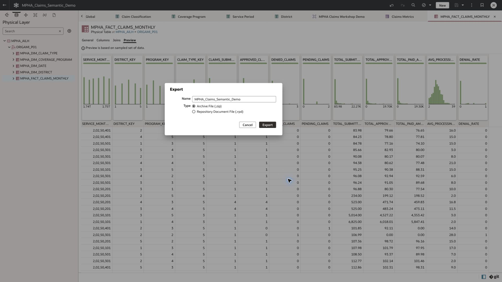

## Source and runtime acceptance boundary

The existing semmodel connection successfully returned sampled live physical fact data, shown below. Full-source totals, dimension completeness and deployed subject-area queries were not tested in Industry Analytics. If extending this slot to runtime analytics, first run sql/ORIGAMI_P01_ReadOnly_Acceptance.sql as the intended source user and reconcile the results. Use the environment owner’s separate approved test deployment process; this private model must not replace the shared Industry Analytics runtime. Do not display the earlier 1,400-claim control total as a verified P01 result.

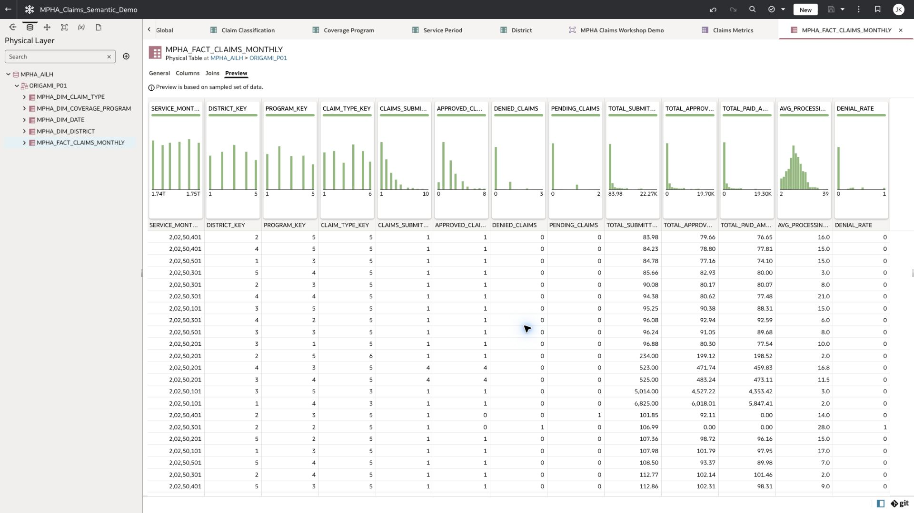

[Oracle documentation for System connections](https://docs.oracle.com/en/cloud/paas/analytics-cloud/acmdg/semantic-model-data-source-connections.html)

[Oracle documentation for generated logical names](https://docs.oracle.com/en/cloud/paas/analytics-cloud/acmdg/automatically-rename-logical-columns.html)

[Oracle documentation for presentation table descriptions](https://docs.oracle.com/en/cloud/paas/analytics-cloud/acmdg/generate-presentation-table-description.html)

[Oracle documentation for presentation column descriptions](https://docs.oracle.com/en/cloud/paas/analytics-cloud/acmdg/generate-presentation-column-description.html)
