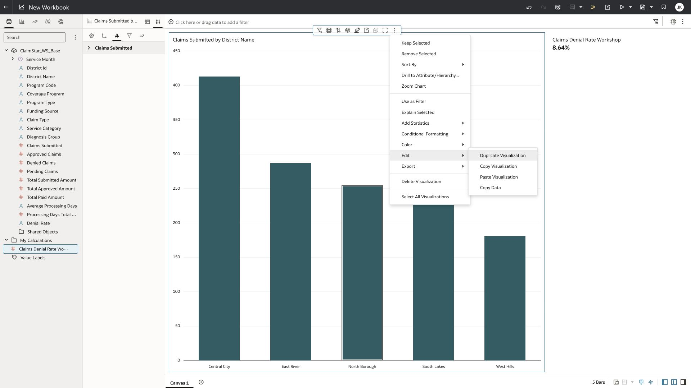
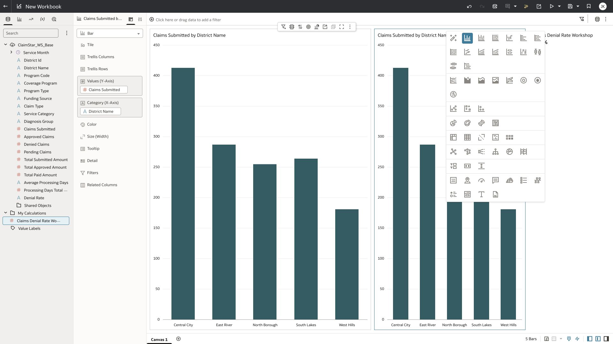
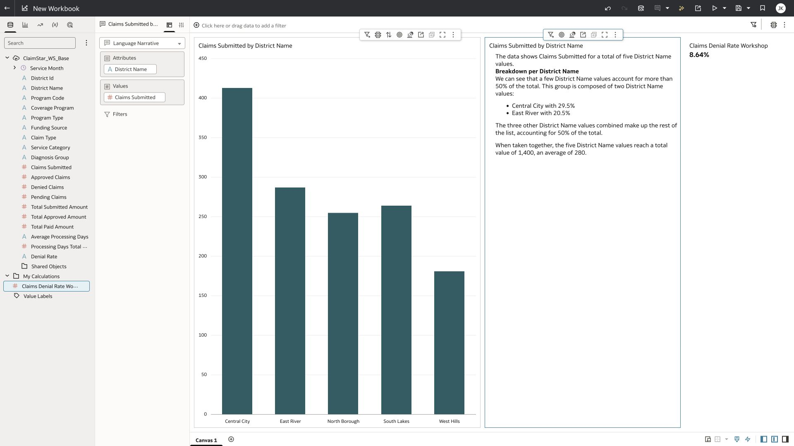
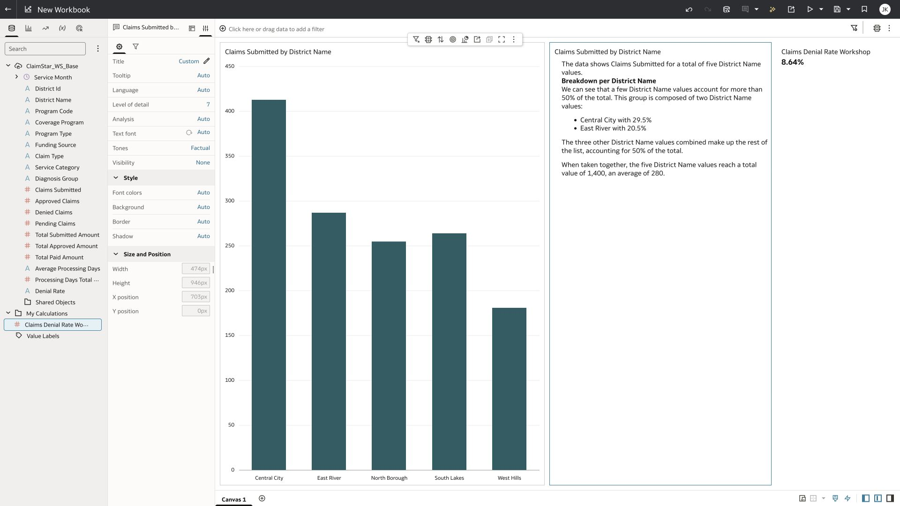
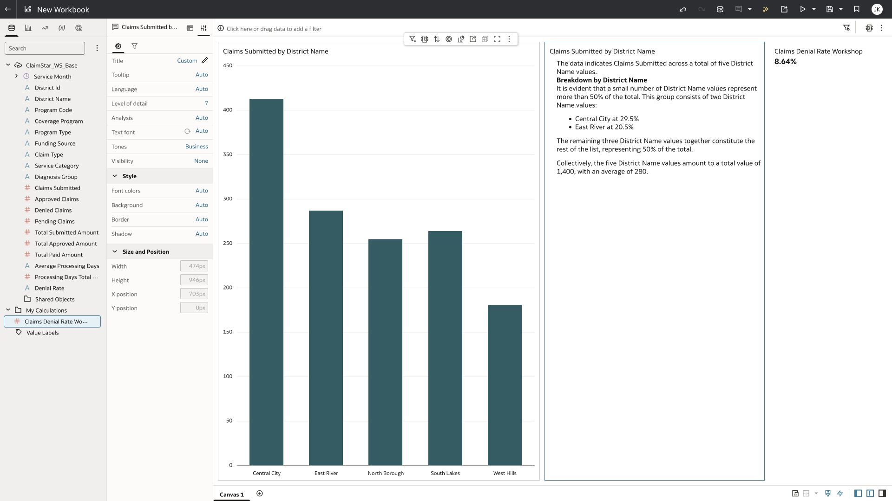
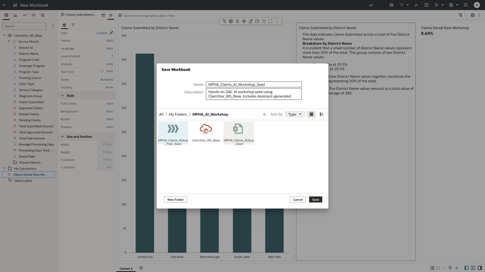
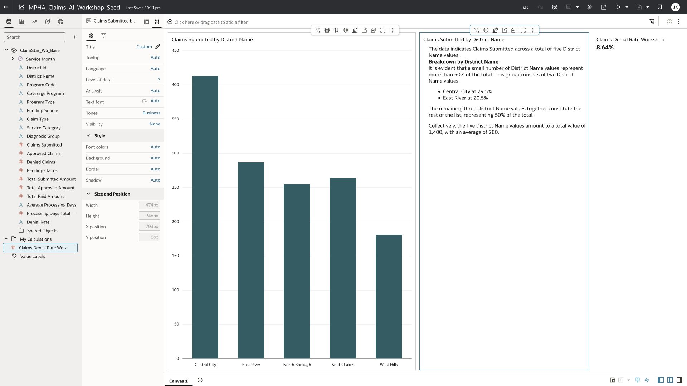

# Lab 8 Add and challenge a Language Narrative

**Time:** 15 minutes  |  **Rehearsal status:** Verified with wording review

You will place a narrative beside the district chart and compare Factual and Business tones. The narrative must stay tied to the selected measures and dimensions; it cannot explain why denials happen from these aggregates alone.

## Task 1 Duplicate the district chart

1. Open Claims_AI_Pxx in workbook authoring mode and select the district claims volume chart.
2. On that visualization, open Menu, Edit, then Duplicate Visualization.
3. Select the duplicate and open Change Visualization Type. Choose Language Narrative.
4. Confirm the assignments are District Name under Attributes and Claims Submitted under Values. Wait for the factual text to appear.

*Duplicate Visualization under the chart Edit menu.*

*Language Narrative in the visualization type picker.*

*Factual narrative generated from district claims volumes.*

## Task 2 Compare tones

1. Select the narrative. Open Properties using the sliders icon beside Grammar, then General.
2. Locate Tones. Change Factual to Business and wait for the generated text.
3. Compare wording, retained numbers, and level of detail. Use a lower detail level if needed for an executive audience, then verify the shortened result.
4. Keep the workbook in authoring mode for the live demonstration. The cited Oracle documentation lists presentation-mode and embedding limitations for Language Narrative.

*Narrative properties including Tones and Level of detail.*

*Actual Business-tone output in the workbook.*

## Task 3 Verify the wording and save

1. Check the total of 1,400, five districts, and average district volume of 280 against the chart.
2. Check Central City plus East River: 413 + 287 = 700, exactly 50% of all claims. The generated rehearsal text said more than 50%. Identify that wording error rather than repeating it as a finding.
3. Explain that tone changes do not validate the analysis. Avoid turning geographic differences into causal clinical conclusions.
4. Save your workbook. Use the prepared seed to recover if you cannot finish the formatting.

*Saving the reusable rehearsal workbook. Participants use Claims_AI_Pxx.*

*Saved MPHA_Claims_AI_Workshop_Seed containing the chart, denial KPI, and narrative.*

## Checkpoint

A narrative sits beside the district chart; the denial KPI still displays 8.64%. You can name a numerical check and a wording check used to review the narrative.

[Oracle hands-on tutorial for narrative authoring](https://docs.oracle.com/en/cloud/paas/analytics-cloud/tutorial-add-language-narrative-visualization/)

[Oracle documentation for narrative limitations](https://docs.oracle.com/en/cloud/paas/analytics-cloud/acubi/language-narrative-visualization.html)

[Back to workshop contents](../README.md)
