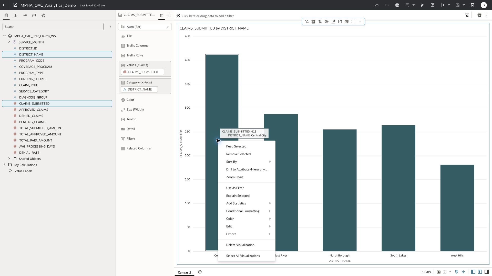
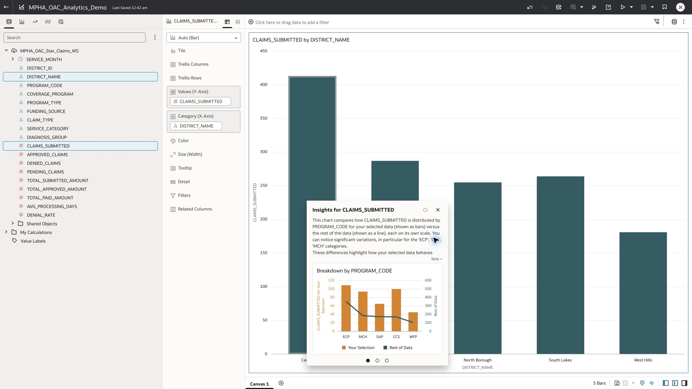
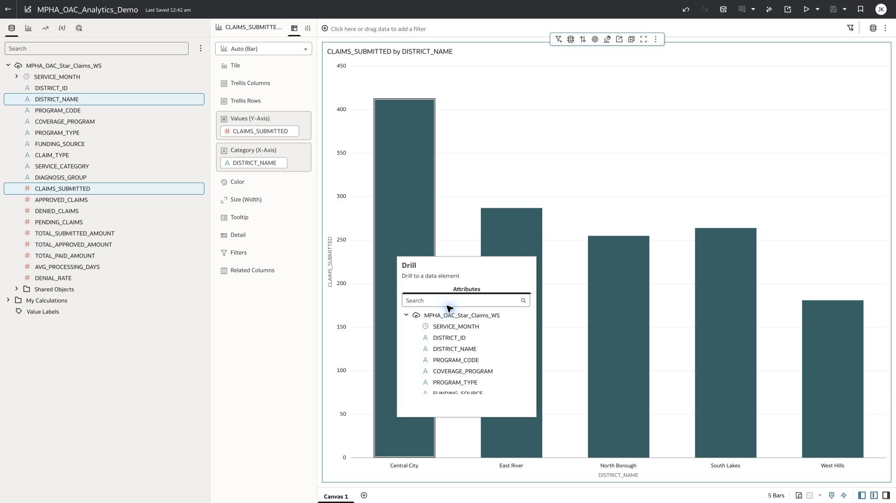
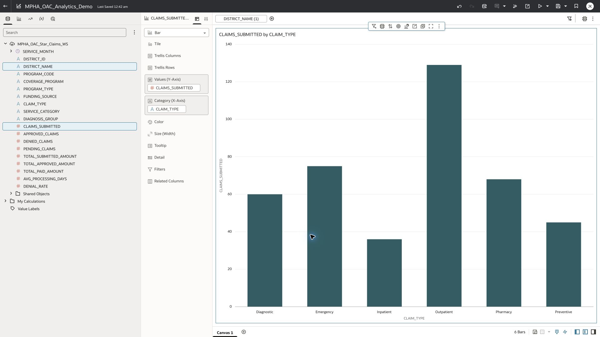
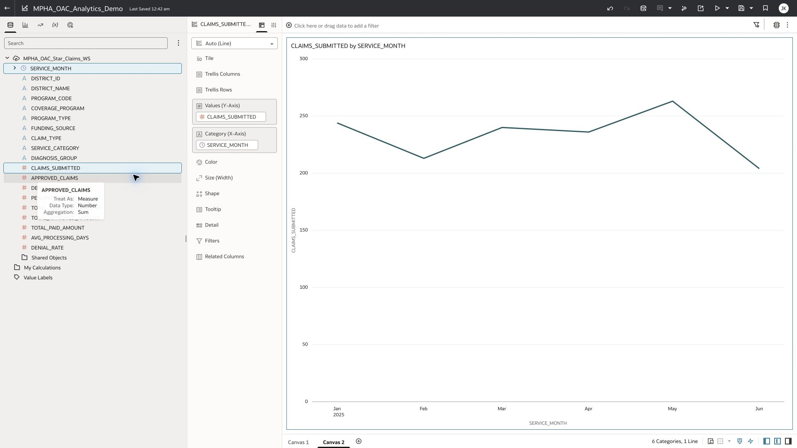
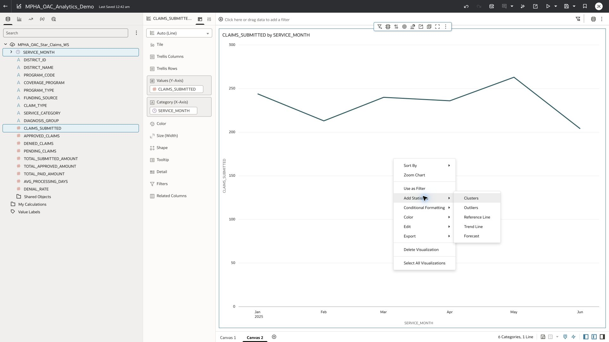
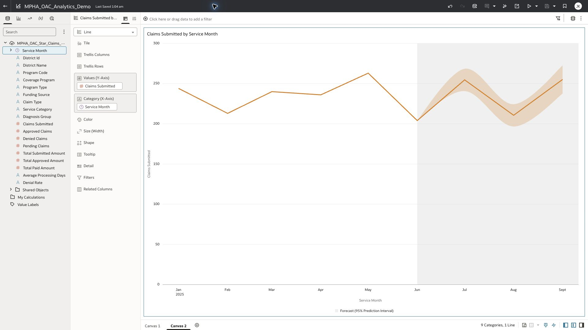

# Exercise 7: Explain Selected, built-in drill and one-click Forecast

25 minutes · Verified in the saved instructor workbook

## Task 1 Explain why Central City deserves attention (8 minutes)

1. Select the five-district Claims Submitted bar chart on its own canvas. Right-click the Central City bar (413) and choose Explain Selected.
2. Read the selected-versus-rest breakdown. Rehearsal highlighted differences across coverage programs; inspect the names and values, then state a question for further investigation.
3. Expand the explanation where offered. Check the axis labels: selected bars and the rest-of-data line may use separate scales. Compare actual values/mix, not the apparent height across those axes. Central City has 413 submitted; other districts total 987.
4. Explain that this is a contextual comparison, not causal proof or a claim-denial prediction. Close the dialog. If preparing a consumer demo, enable Explain visualization in the chart’s properties and the relevant Present visualization actions.

## Task 2 Drill from district workload to claim-type mix (7 minutes)

1. Right-click Central City again → Drill to Attribute/Hierarchy. Choose Claim Type in the column chooser.
2. Confirm the chart now has six claim types and the filter bar retains District Name = Central City. You are exploring the selected district, not replacing the chart with all-district claim types.
3. Check that the drilled claims total remains 413. Discuss which service mix contributes to workload; compare denial counts/rates separately before making a quality claim.
4. Use Undo once to return to all five districts, or remove the drill/filter deliberately. Save only after restoring the intended overview. This attribute drill works on the flattened dataset; an explicit semantic hierarchy is optional.

## Task 3 Add a forecast in one click (10 minutes)

1. Create a separate canvas for the monthly forecast. Select Claims Submitted and Service Month, then Create Best Visualization → Line, or drag the measure to Values and date to Category. Verify six observed months, January–June 2025.
2. Right-click the line chart → Add Statistics → Forecast. The same menu offers Trend Line, Clusters and Outliers for appropriate charts/data.
3. Inspect the Analytics/Forecast settings: Periods = Next 3; the tested default was Seasonal ARIMA with a 95% prediction interval. Check the band and three projected months July–September 2025.
4. Distinguish the six historical points from the forecast and prediction band. Save the workbook. Do not imply six months are sufficient evidence for reliable seasonality or an operational healthcare forecast.
5. To demonstrate a decision workflow, ask: “What more history and hold-out testing would we need before staffing to this forecast?” This is a capability demonstration using short synthetic history.

[Oracle: chart contextual insights](https://docs.oracle.com/en/cloud/paas/analytics-cloud/acubi/explore-contextual-insights-visualization.html)

[Oracle: consumer visualization actions](https://docs.oracle.com/en/cloud/paas/analytics-cloud/acubi/specify-workbook-visualization-actions.html)

[Oracle: add a forecast](https://docs.oracle.com/en/cloud/paas/analytics-cloud/acubi/add-forecast-visualization.html)
